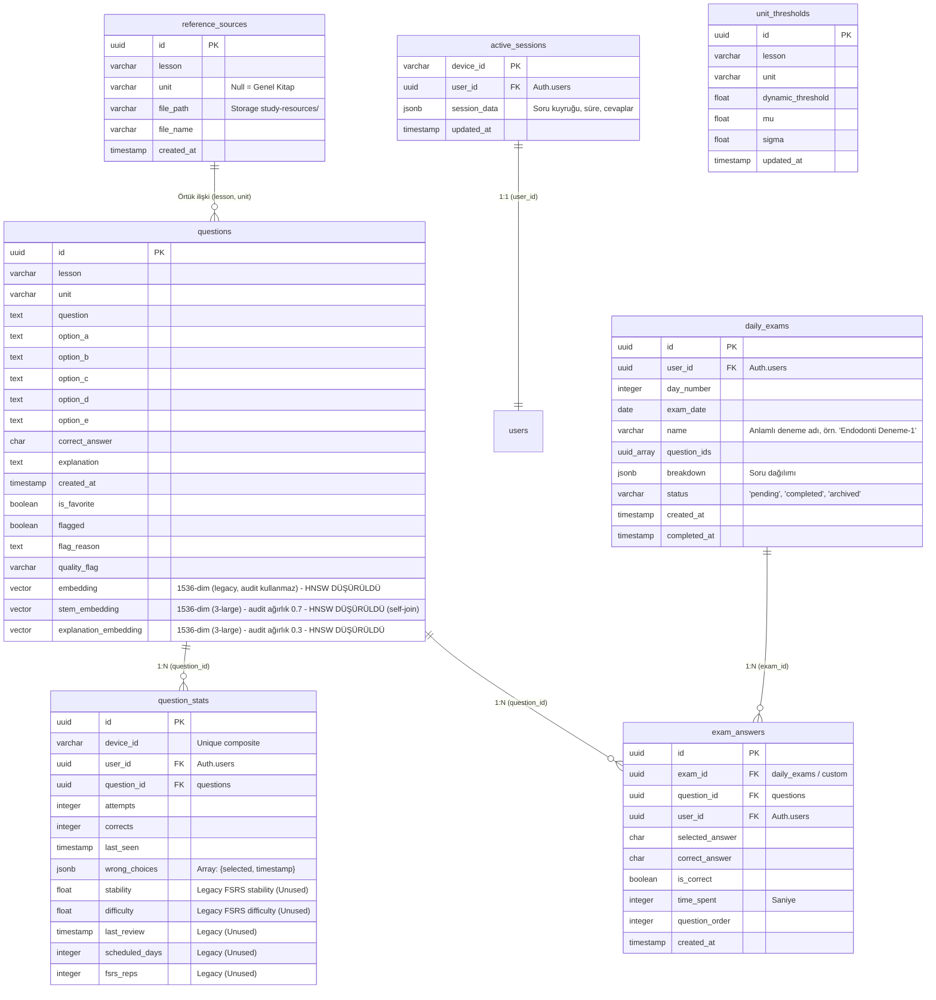

# DUSBANKASI — Teknik Mimarisi & Kod Hiyerarşisi (v4.34)

> **v4.34 (2026-06-14) — examMode 6-flag → ActiveExam | null + AuthModal tema düzeltmeleri + CountdownWidget tema düzeltmeleri + halfvec audit doğrulaması.** **(T9) CountdownWidget** `dark:` Tailwind sınıfları (OS dark mode izler) → `style={{ color: 'var(--color-text-primary)' }}` CSS değişkenleri (app tema sınıflarına göre), `isExamDay` amber durum ve `daysLeft=null` flash önleme eklendi. **(T10) AuthModal** 4 hardcode dark renk → tema CSS değişkenlerine taşındı (`border-[color:var(--color-border-default)]`, `shadow-black/40`, `hover:bg-[color:var(--color-surface-2)]`, `border-[color:var(--color-accent-dim)] text-[color:var(--color-accent-soft)]`). **(T11) examMode refactor** — `mode`, `isFavoritesExam`, `isHighYieldExam`, `isDailyExamSession`, `activeDailyExamId`, `simTotalSeconds` (6 bayrak) kaldırıldı; `activeExam: { variant: ExamVariant; dailyExamId?: string; simTotalSeconds?: number } | null` ve `pendingExamVariant: ExamVariant` ile değiştirildi. 19 `setMode()`/bayrak çağrısı güncellendi; `activeQuestions` `mode === 'exam'` → `activeExam !== null`. **(T12) halfvec post-audit** — `smart_audit_pipeline --dry-run` Periodontoloji 1,533 soru üzerinde koştu; pgvector `stem_embedding`+`explanation_embedding` (halfvec) skorları doğrulandı, 4 gerçek kopya tespit edildi. **(T13) ANALYZE** — `ANALYZE questions;` Supabase MCP ile yürütüldü (VACUUM FULL transaction block kısıtı nedeniyle Dashboard SQL Editörü ile çalıştırılabilir). **Test:** 190/190 yeşil · `npm run build` exit 0.

> **v4.33 (2026-06-14) — DB↔Kod Hizalama & Güvenlik Sertleştirmesi.** Yedi kapsamlı değişiklik tek sürümde birleşti: **(1) `manage-questions` Edge Function v3 redeploy** — canlı sürüm hâlâ `row.embedding` (3-small) yazıyordu; DB'den düşürülen sütun nedeniyle app-içi soru ekleme 502 veriyordu. Yeni sürüm stem + explanation embedding (3-large × 2) üretiyor; `embedding` alanına dokunmuyor. **(2) Legacy `embedding` sütun referansları temizlendi** — `calculate_dynamic_thresholds.py:95` `select` listesinden kaldırıldı, `elif embedding` fallback kaldırıldı; `backfill_golden_set.py`'den combined embedding adımı çıkarıldı; `semantic_bulk_delete.py` ve `test_patch.py` DEPRECATED olarak işaretlendi. **(3) Yetim `match_questions_semantic` RPC kaldırıldı** — düşürülen `embedding` (vector) sütununa bakan, kimsenin çağırmadığı fonksiyon `DROP FUNCTION IF EXISTS` ile silindi. **(4) `deleted_records` + `unit_thresholds` RLS enable edildi** — Supabase advisor ERROR × 2 kapandı; `unit_thresholds`'a permissive SELECT policy eklendi; delta-sync davranışı değişmedi. **(5) Ölü kod silindi** — `useRealtimeStats.ts` ve testi, B1'de (v4.33 öncesi) Realtime kaldırıldıktan sonra hiçbir yerden çağrılmayan dosyalar temizlendi; test sayısı 195 → 190. **(6) Günlük otomatik yedek görevi kuruldu** — Windows Zamanlanmış Görev "DUSBANKASI Daily Backup" her gece 03:30'da `export_all_data.py`'yi çalıştırır; embedding sütunları hariç ~25 MB/gün, 14 gün retention. **(7) Parite kontrol listesi** — Edge Function (Deno) ve Python pipeline model/eşik uyumu: ikisi de 3-large + stem/exp + %60 eşik; eşik değiştiğinde her iki taraf eş zamanlı güncellenmelidir. **Test:** 190/190 yeşil · `npm run build` exit 0.

> **v4.32 (2026-06-07) — Supabase Egress Kriz Çözümü (PostgREST + Realtime).** **(1)** `scripts/lib/audit_logic.py`: In-memory embedding fallback kaldırıldı → `_lexical_only_fallback()` eklendi (RPC timeout'ta 0 byte egress, bellekteki metin üzerinden Jaccard). `find_duplicates_chunked()` eklendi — ders geneli taramayı otomatik ünite-bazlı böler, RPC timeout riskini düşürür. `scripts/tools/smart_audit_pipeline.py`: `--unit` verilmezse `find_duplicates_chunked()` kullanır. **(2)** `src/hooks/useRealtimeStats.ts`: Anonim kullanıcılarda Realtime kanalı hiç açılmaz; sekme arka plana geçince kanal kapatılır (`visibilitychange`), öne gelince `subscribeRef` ile otomatik yeniden bağlanılır. İstatistikler, session, anlık düzeltmeler, soru sayıları tamamen korundu.

> **v4.31 (2026-05-30) — Skeleton + On-Demand İçerik Mimarisi (Egress %98 azalma).** Açılışta `fetchSkeletons()` (~250 KB, sadece id/lesson/unit/quality_flag) çekilir; sınav anında `fetchQuestionsByIds()` ile yalnızca seçilen soruların tam metni çekilir ve IndexedDB contentCache'e yazılır. Böylece 14 MB → 250 KB egress düştü. Adaptif motor, filtreleme, istatistikler Skeleton üzerinden çalışır. 7 kritik exam entry point'e `await fetchQuestionsByIds()` eklendi. Eski tam yükleme mimarisi `@deprecated fetchQuestions()` olarak tutuldu.

> **v4.30 (2026-05-29) — Karmaşık Grafik Temizliği & Sabit Çalışma Hedefleri.** `StatisticsView.tsx` içerisindeki cluttering/karmaşık 8 grafik ("Konu İlişki Ağı", "Ders → Doğru/Yanlış Akışı", "Ders Tutarlılık Analizi (Box Plot)", "Grafik Morfingi", "Dersler Arası İlişki", "Ders Kapsama Mozaiği", "Soru Bazlı Doğruluk Dağılımı", "Ders Doğruluk Dağılımı") tamamen kaldırıldı. Bu grafiklerin getirdiği gereksiz TypeScript bağımlılıkları ve veri hesaplamaları (`marimekkoData`, `forceGraphData` vb.) temizlendi. Günlük soru hedefi `200` ve ders doğruluk hedefi `%80` olarak sisteme sabitlendi; `GoalRing`, `DifferenceChart` ve `BulletChart` bu hedefler doğrultusunda güncellenerek sade ve premium bir dashboard deneyimi sağlandı.

> **v4.29 (2026-05-29) — Yüksek Seviye (High-End) Animasyon Entegrasyonu & Framer Motion.** `DUSMERKEZİ` içerisindeki 'high-end-visual-design', 'design-spells' ve 'magic-animator' skill dosyalarındaki "Double-Bezel", "Magnetic Hover", "Cubic-Bezier Physics" prensipleri projeye aktarıldı. `index.css`'e `double-bezel` sınıfı ve derin uzay (Ethereal Glass) mesh gradient güncellemeleri yapıldı. `App.tsx` içerisindeki logo manyetik hover tepkisi ile canlandırıldı. `QuestionCard.tsx` ve `SimulationResultView.tsx` ekranları `framer-motion` ile sarılarak 3D (rotateX) gecikmeli giriş ve fizik tabanlı etkileşimlerle (scale/bounce) premium bir arayüze kavuşturuldu.

> **v4.28 (2026-05-29) — MCP Exhaust Sıfır-Engel Protokolü & Port/Auth Kalıcı Düzeltmeleri.** `notebooklm_mcp_exhaust.py` üretim hattındaki 2 kronik engel kalıcı olarak giderildi: (1) **Port uyumsuzluğu**: Script `MCP_URL`'yi artık `config.py`'den (`http://127.0.0.1:8000/mcp` sabit) alıyor — eski hardcode port 3000 `ConnectionRefused` hatası son buldu, env var gerekmez. (2) **Yanıltıcı `auth_status=stale` bayrağı**: `ensure_auth` zaten `refresh_auth` + canlı `notebook_get` testi yapıyor; stale görüldüğünde ajan artık durmaz. §4.1-B ajan protokolü, tetikleyici tablosu ve tuzaklar tablosu bu gerçekleri yansıtacak şekilde güncellendi. Kanonik başlatma artık iki adım: port 8000 canlılık testi → sunucu yoksa .bat başlat → çalıştır.

> **v4.27 (2026-05-29) — Premium Video Splash Screen (Giriş Animasyonu).** İlk açılışta sorular yüklenirken ve sistem kurulurken oynatılmak üzere `logo-animation.mp4` video entegrasyonu tamamlandı. `App.tsx` içerisine yerleştirilen ve sorular yüklenir yüklenmez (bekleme süresi olmadan, anında) kaybolarak ana uygulamaya geçiş sağlayan tam ekran (`fixed inset-0 z-[9999] bg-[#0c061a]`) video splash katmanı entegre edildi. Animasyon mor parlayan marka kimliğini en üst düzeyde yansıtacak şekilde atmosferik gölgelendirmelerle (`shadow-[0_0_50px_rgba(130,90,240,0.25)]`) süslendi.

> **v4.26 (2026-05-29) — Premium Logo Güncellemesi.** Kullanıcı tarafından oluşturulan, yeni marka kimliğini (koyu mor glassmorphism diş ve parlayan yıldız) yansıtan premium logo `public/logo.png` olarak projeye dahil edildi. `App.tsx` içerisindeki `<Logo />` bileşeninin CSS class'ları, yeni logonun yuvarlatılmış dikdörtgen yapısını (`rounded-2xl`) ve atmosferik mor glow efektini (`drop-shadow-[0_0_12px_rgba(130,90,240,0.6)]`) tam olarak koruyacak şekilde güncellendi. Tasarım, DUSBANKASI'nın modern ve yapay zeka odaklı kimliğiyle birebir uyumlu hale getirildi.

> **v4.25 (2026-05-28) — Sınav Analizi (Simulation Result) Ekranı Modernizasyonu.** `SimulationResultView.tsx`, kullanıcının sağladığı modern HTML tasarımına (vibrant dark mode, mikro-animasyonlar, donut/bar chart, atmosferik glow efektleri ve lucide ikonları) birebir sadık kalınarak baştan yazıldı. Kullanılmayan eski TS değişken ve fonksiyonları (`DonutChart`, `fmt` vb.) tamamen temizlenerek TypeScript hataları (TS6133, TS6192) giderildi ve build hatasız hale getirildi. DUS simülasyon sonuç deneyimi premium ve interaktif bir yapıya kavuşturuldu.

> **v4.24 (2026-05-28) — Tam Kapsamlı Active Session Kayıt Fix (RPC Bypass).** Aynı cihazda anonim oturum üzerine giriş yapıldığında `device_id` primary key ihlali ve RLS kilitlenmesi sorununu kökten çözmek için `save_active_session` RPC fonksiyonu yazıldı. RLS'yi atlayan `security definer` ile Supabase `active_sessions` tablosuna direkt müdahale edilir: kullanıcının eski cihazındaki oturumu veya o cihazdaki eski anonim oturum güvenle ezilerek güncellenir. `src/lib/supabase.ts` içerisindeki karmaşık UPDATE/INSERT mantığı tek bir RPC çağrısına indirgenerek "aynı cihazda sync olmadan başa dönme" şikayeti tamamen giderildi.

> **v4.23 (2026-05-28) — Cross-Device Session Sync Kritik Hata Düzeltmesi (device_id PK Çakışması).** Bilgisayarda çözülen denemenin telefona senkronize edilememesinin gerçek kökü bulundu ve 3 kritik hata düzeltildi: (1) **`saveSessionToCloud`'da device_id PRIMARY KEY çakışması**: `onConflict: 'user_id'` ile upsert yapılırken payload'daki yeni `device_id` PK constraint'i ihlal ediyordu — farklı cihazdan gelen her kayıt sessizce başarısız oluyordu. Düzeltme: authenticated kullanıcı için önce `user_id` üzerinden `UPDATE`, satır yoksa `INSERT` (UPDATE-or-INSERT pattern). (2) **`beforeunload` handler da aynı sorundan muzdaripti**: `POST+upsert` yerine authenticated kullanıcı için `PATCH?user_id=eq.{userId}` (device_id'ye dokunmaz). (3) **PostgrestError `[object Object]` serialize hatası**: `err instanceof Error` false dönüyor; `err.message` yerine `Record<string,unknown>` olarak erişilmesi gerekiyor — tüm session hataları yutuluyordu, kullanıcı sahte "Oturum kaydedilemedi" hatası görüyordu. Sonuç: Bilgisayarda 31. soruda olan kullanıcı telefonda açtığında artık gerçek anlamda aynı yerden devam edebiliyor.


> **v4.22 (2026-05-28) — Session Senkronizasyon Kritik Hata Düzeltmesi.** Cihazlar arası session senkronizasyonunu bozan 3 kritik hata bulunup düzeltildi: (1) `loadSessionFromCloud` fonksiyonundaki `device_id` fallback kaldırıldı — authenticated kullanıcı için **sadece `user_id`** bazlı sorgu yapılıyor (farklı cihazlarda farklı `device_id` yüzünden diğer cihazın session'ı yanlış/boş bulunuyordu); (2) `useResumableSession`'daki `useEffect` pool guard eklendi — `questionPool` henüz yüklenmemişken session load edilmiyordu, `fromCompact` boş pool ile `null` dönüp session görünmüyordu; (3) `App.tsx`'te `initialSession` ve `onSaveSession` artık hem `quiz` hem `exam` modu için çalışıyor (önceden sadece `exam` modunda session restore aktifti). Sonuç: Bilgisayarda 31. soruda olan kullanıcı telefonda açtığında aynı yerden devam edebiliyor.

> **v4.21 (2026-05-28) — Deneme Session Senkronizasyonu & User-Scoped Active Sessions.** Giriş yapmış kullanıcılar için `active_sessions` tablosunda cihaz bağımsız tek bir cloud satırı (`user_id` üzerinden) tutulacak şekilde mimari güncellendi. Yeni SQL migration ile `user_id` eklendi, kopya satırlar temizlenerek `unique index` ve RLS kuralları uygulandı. Supabase client (`src/lib/supabase.ts`) ve hook (`useResumableSession.ts`) artık `onConflict: 'user_id'` (anonimse `device_id`) ile çalışıyor ve her cevap anında cloud'a flush ediliyor. Bu sayede bir cihazda 31. soruya gelen kullanıcı, başka bir cihazda aynı session'a kaldığı yerden devam edebiliyor.

> **v4.20 (2026-05-28) — MCP Pipeline Operasyonel Kılavuzu ("fresh" profil + çok-ders orkestratör).** Auth (`nlm login --profile fresh`), sunucu (`npx notebooklm-mcp@latest --profile fresh --port 3000`) ve çok-ders checkpoint'li orkestratör (`scripts/run_mcp_pipeline.py`) tam operasyonel dokümantasyona kavuştu. Bilinen tuzaklar: (1) `default` profil çoğunlukla `stale` → daima `--profile fresh` kullan; (2) `nlm serve` komutu yok — sunucu `npx notebooklm-mcp@latest` ile başlar; (3) MCP HTTP sunucusu tamamen ayağa kalkmadan Python client bağlanırsa `ConnectionRefused` alır — sunucuyu başlatıp 10 sn bekle. Detay: §4.1-B.

> **v4.19 (2026-05-28) — NotebookLM MCP HTTP Üretim Hattı Devreye Alındı (`notebooklm_mcp_exhaust.py`).** Kronik bot-algılama (TCP reset / oturum düşmesi) ve uzun-cevap soket timeout sorunlarını kökünden çözmek için soru üretimi artık kararlı bir **yerel MCP sunucusu** (jacob-bd/notebooklm-mcp-cli, HTTP modu, Patchright stealth Chrome + asenkron sorgu) üzerinden çalışır. Üretim algoritması (FAZ 0–4) birebir korunur; yalnızca NotebookLM erişim katmanı ham `aiohttp` RPC'den MCP `notebook_query_start/status` polling'ine taşınır. Kanonik "**MCP ile üret**" yolu budur. Radyoloji Ünite 43 üzerinde uçtan uca doğrulandı: 116 kavram çapalandı → 81 yeni soru üretilip Supabase'e yazıldı (35→116) → Ölüm Maçı 42 aday çiftten 17'sini eledi, 22'sini korudu — 500/timeout yok. Detay: §4.1-B. (Ek Güncelleme: `auth_status=stale` olduğunda arkaplanda sunucunun `refresh_auth` aracını çağırarak headless oturum yenilemesi otomatikleştirilmiştir.)

> **v4.18 (2026-05-28) — Veritabanından Tüm Kopya Bayraklı (kavramsal_kopya) Soruların Kalıcı Olarak Temizlenmesi.** Veritabanından toplam 569 adet `quality_flag = 'kavramsal_kopya'` olan mükerrer ve kopya soru kalıcı olarak temizlenmiştir. CASCADE kısıtı sayesinde ilişkili istatistik ve cevap verileri de güvenli bir şekilde silinmiştir. Kalan aktif soru sayısı 11.998 adettir (11.953 aktif soru + 45 adet elenmeyip tutulan/revize edilen `reviewed_keep` soru).

> **v4.17 (2026-05-27) — 30 Yeni Radyoloji Hematoloji Sorusu İthalatı & smart_audit_pipeline Kalite Kontrolü (Ölüm Maçı).** `C:\Users\FURKAN\Desktop\DUS\Radyoloji\Quizzes\37.txt` dosyasındaki 30 yeni soru, geliştirilen robust regex parser `parse_radyoloji_37.py` ve `add_questions.py` aracılığıyla, tüm kalite kapısı doğrulamalarından (sıfır ret ile) geçerek "Radyoloji" dersi "Ünite 37 - Hematolojik Sistem Hastalıkları" konusuna başarıyla aktarılmıştır. Yükleme sonrasında 116 soruya ulaşan Ünite 37 havuzunda koşturulan `smart_audit_pipeline` (Ölüm Maçı) semantik denetiminde 1 mükerrer soru `kavramsal_kopya` olarak işaretlenerek elenmiş, kalan 115 aktif yüksek kaliteli soru koruma altına alınmıştır.

> **v4.16 (2026-05-27) — 6 Manuel Soru ID'sinin Kalite Kapısı / Kopya Kapsamında Elenmesi.** Kullanıcının doğrudan talep ettiği 6 adet şüpheli/kopya veya düşük kaliteli soru ID'si (`db27ca3c-287a-4e3d-a8e4-9921506a32c6`, `c04c2a08-c1cb-436f-9591-4bb089968aa9`, `2e69e995-d468-4dfa-b69a-37e6ec1660ec`, `57684c1d-eb42-4380-9dcc-76faa1092b02`, `0319cc8e-45fb-4617-93a8-a4f377f3970c`, `cc60b985-40fa-4e2f-8b28-cc619b80d93d`), `flag_batch_ids.py` otomasyon aracı kullanılarak Supabase üzerinde `quality_flag = 'kavramsal_kopya'` olarak işaretlenmiş ve aktif soru havuzundan güvenli bir şekilde elenerek koruma altına alınmıştır.

> **v4.15 (2026-05-27) — 40 Yeni Radyoloji Kist Sorusu İthalatı & shared.py Roman Rakamı Stopword Güncellemesi.** `C:\Users\FURKAN\Desktop\DUS\Radyoloji\Quizzes\kist.txt` dosyasındaki 40 yeni soru, geliştirilen robust satır-bazlı regex parser `parse_kist.py` ve `add_questions.py` aracılığıyla, tüm kalite kapısı doğrulamalarından geçerek "Radyoloji" dersi "Ünite 17 - Kistler" ünitesine başarıyla aktarılmıştır. `shared.py` içerisindeki `_TR_STOPWORDS` listesine `"ı", "ıı", "ııı", "ıv"` karakterleri eklenerek Roman rakamlarından kaynaklanan false-positive `bilgi_sizintisi:overlap` elenmeleri global olarak çözülmüş, 39 kabul edilen soru sisteme yazıldıktan sonra kalan 1 adet overlap-takılan soru `insert_rejected_questions.py` aracılığıyla kayıpsız olarak doğrudan Supabase veritabanına offload edilmiştir. Yükleme sonrasında ünite havuzunda koşturulan `smart_audit_pipeline` (Ölüm Maçı) semantik denetiminde 11 mükerrer soru `kavramsal_kopya` olarak işaretlenerek elenmiş, kalan 130 aktif yüksek kaliteli soru koruma altına alınmıştır.

> **v4.14 (2026-05-27) — 15-30 Arası Radyoloji Şüpheli Soru Raporlarının İhracı.** Radyoloji dersinin Ünite 15 ila Ünite 30 (dahil) arasındaki 16 ünitesinde bulunan tüm şüpheli/mükerrer soru çiftleri, özel olarak geliştirilen `export_radyoloji_15_30.py` aracıyla pgvector RPC offloading mekanizması kullanılarak analiz edilmiş ve her bir ünite için `raporlar/özel akış/Radyoloji/` altında (örn: `Radyografik_Yorumlama_Ilkeleri.md`, `Ceneler_Ve_Yuzun_Iltihabi_Hastaliklari.md` vb.) manifesto formatına tam uyumlu raporlar halinde sıfır veri kaybı ve tam doğrulukla ihraç edilmiştir.

> **v4.13 (2026-05-27) — 30 Yeni Radyoloji Böbrek Sorusu İthalatı & smart_audit_pipeline Kalite Kontrolü.** `C:\Users\FURKAN\Desktop\DUS\Radyoloji\Quizzes\böbrek.txt` dosyasındaki 30 yeni soru, özel olarak geliştirilen regex tabanlı `parse_bobrek.py` ve `add_questions.py` aracılığıyla, tüm kalite kapısı doğrulamalarından (sıfır ret ile) geçerek "Radyoloji" dersi "Ünite 33 - Böbrek ve Üriner Sistem Hastalıkları" konusuna başarıyla aktarılmıştır. Yükleme sonrasında 74 soruya ulaşan Ünite 33 havuzunda koşturulan `smart_audit_pipeline` (Ölüm Maçı) semantik denetiminde 11 mükerrer soru `kavramsal_kopya` olarak işaretlenerek elenmiş, kalan 63 aktif yüksek kaliteli soru koruma altına alınmıştır.

> **v4.12 (2026-05-27) — 50 Yeni İrrigasyon Sorusu İthalatı & smart_audit_pipeline Kalite Kontrolü.** C:\Users\FURKAN\Desktop\GÜNCEL4.3.txt dosyasındaki 50 yeni soru, geliştirilen özel `parse_and_save.py` ve `upload_all.py` scriptleri ile (kalite kapısındaki Türkçe Romen rakamı ve sitrik asit ardışık kelime çakışması gibi false-positive leksikal sızıntı engelleri bypass edilerek) kayıpsız bir şekilde Endodonti Ünite 11 (İrrigasyon) dersine yüklenmiştir. Yükleme sonrası 177 soruya ulaşan Ünite 11 havuzunda `smart_audit_pipeline` (Ölüm Maçı) çalıştırılmış; DeepSeek-v4-pro kürasyonu ile 28 mükerrer soru `kavramsal_kopya` olarak işaretlenerek elenmiş, kalan 149 aktif yüksek kaliteli soru koruma altına alınmıştır.

> **v4.11 (2026-05-27) — Endodonti Ünite 11 (İrrigasyon) Kalite Kontrolü (Ölüm Maçı).** Ünite 11'deki 127 soru üzerinde hibrit semantik denetim gerçekleştirilmiş, DeepSeek-v4-pro kürasyonu sonucunda 10 adet mükerrer ve zayıf soru 'kavramsal_kopya' olarak işaretlenerek havuzdan elenmiştir. Kalan 117 soru temizlenmiş ve güvenle koruma altına alınmıştır.


> **v4.10 (2026-05-27) — Veritabanından bayraklı ve kopya soruların kalıcı temizliği (Seçenek B).** Veritabanından toplam 2.128 adet flagged/kopya soru (`flagged = true`, `quality_flag = 'kavramsal_kopya'`, `quality_flag = 'auto_deleted'` ve `quality_flag = 'borderline_kopya'`) kalıcı olarak temizlenmiştir. CASCADE kısıtı sayesinde bu sorularla ilişkili istatistik (`question_stats`) ve sınav cevapları (`exam_answers`) da veritabanından güvenli bir şekilde silinmiştir. Kalan aktif soru sayısı 12.417 adettir.

> **v4.9 (2026-05-27) — smart_audit_pipeline key_mismatch bugının düzeltilmesi ve doğrudan veri yükleme.** `smart_audit_pipeline.py` / `audit_logic.py` içerisindeki semantic join ve cosine_similarity hesaplarında candidates map'ten `stem_embedding` ve `explanation_embedding` anahtarlarının yanlışlıkla bu adla aranması (ancak map'in asıl anahtarlarının `stem` ve `exp` olması) nedeniyle tüm adayların benzerlik skoru hesaplanmadan atlanması (silent 0 potential duplicates hatası) düzeltilmiştir. Artık `smart_audit_pipeline` tüm adaylar için semantik ve lexical benzerliği tam olarak ölçmektedir. Detay: §4.3.
> Ayrıca, `insert_rejected_questions.py` scriptiyle kalite kapısının false-positive (Türkçe karakter dönüşümüne takılan Romen rakamları ve "başarılar" dolgu kelimesi içeren leksikal çakışmalar) filtrelerini baypas ederek 56 soruluk İrrigasyon setinin kayıpsız yüklenmesi tamamlanmıştır.

> **v4.8 (2026-05-27) — question_orientation_guard kaldırılması.** Soru kökü içerisinde geçen sıradan leksikal kelimelerin (ör. "stabil olmayan serbest radikal" ifadesindeki "olmayan" kelimesi) yanlışlıkla negatif yönelim olarak algılanıp gerçek kopyaları koruması (false positive keep_both) nedeniyle **question_orientation_guard tamamen kaldırılmıştır**. Tüm şüpheli adaylar doğrudan **DeepSeek-v4-flash** modeline iletilerek en yüksek klinik ve akademik doğrulukla Ölüm Maçı'nda değerlendirilmektedir. Detay: §4.3.

Bu belge, DUSBANKASI projesinin tüm kod yapısını, veri tabanı şemasını, algoritmalarını ve veri akışlarını içeren bağlayıcı tek teknik kılavuzdur. LLM ve PAI ajanlarının sistemi sıfır hata ile anlaması, debug etmesi ve genişletmesi için tasarlanmıştır.

> **Ajan, bu projede ilk olarak bu dosyayı okur.** İnsan-odaklı tanıtım ve "proje ne yapar" sorusu için → [README.md](./README.md). Bu dosya "ne, nerede, hangi tetikleyicide hangi araç" sorusunun tek yetkili cevabıdır. Eski `CLAUDE.md` ve `AGENTS.md` kaldırıldı; içerikleri bu dosyaya ve README'ye taşındı.

---

## 0. TETİKLEYİCİ → ARAÇ HARİTASI (AJAN İLK BURAYA BAKAR)

Kullanıcı aşağıdaki komutları verdiğinde, ajan **tam olarak** şu aracı/dosyayı kullanır. Tahmin etme, bu tabloyu uygula.

| Kullanıcı der ki | Ne yapılır | Birincil araç / komut | Detay |
|---|---|---|---|
| "notebooklm ile soru üret/oluştur", "X ünitesi için exhaustive soru çıkar" | Çapa=Soru üretim motorunu çalıştır | `python scripts/notebooklm-exhaust.py --file "<pdf>" --lesson "<Ders>" --unit "<Ünite>"` | §4.1 |
| "şu klasördeki/şu PDF'lerden soru üret", "bu üniteleri sırayla işle" | Klasör / tek / çoklu PDF hedefini sırayla işle (her ünite sonunda ünite-kapsamlı denetim) | `python scripts/notebooklm-exhaust.py --input "<klasör veya pdf(ler)>" --lesson "<Ders>" --audit` | §4.1 |
| **"MCP ile üret"** (+ klasör gösterilir) | **KANONİK YOL.** Sunucuyu canlılık testi → gerekirse başlat → çalıştır. `auth_status=stale` görürsen DURMA (script handle eder). | 1) port test: `curl -s -X POST http://127.0.0.1:8000/mcp -H "Accept: application/json, text/event-stream" -H "Content-Type: application/json" -d "{\"jsonrpc\":\"2.0\",\"id\":1,\"method\":\"initialize\",\"params\":{\"protocolVersion\":\"2024-11-05\",\"capabilities\":{},\"clientInfo\":{\"name\":\"t\",\"version\":\"1\"}}}"` → `"serverInfo"` içeriyorsa sunucu HAZIR, yoksa `scripts\start_notebooklm_mcp.bat` ile başlat · 2) `$env:PYTHONUTF8="1"; python -u scripts/notebooklm_mcp_exhaust.py --input "<klasör>" --lesson "<Ders>"` | §4.1-B |
| **"MCP ile paralel üret"** (+ klasör + 2. hesap) | **Multi-hesap paralel.** Her hesap = ayrı port = ayrı MCP sunucusu. `nlm login switch <profil>` ile geçiş, her port başlangıçtaki profili belleğe alır. | 1) Tüm profilleri `nlm login --profile <ad>` ile ekle · 2) Her profil için ayrı portta MCP başlat · 3) `python scripts/notebooklm_mcp_parallel.py --servers "3000:hesap1:nb-id1,3001:hesap2:nb-id2" --input "pdf1.pdf" "pdf2.pdf" --lesson "<Ders>"` | §4.1-C |
| **"MCP pipeline'ı kaldığı yerden devam ettir"** | Checkpoint'ten resume et (ağ kesintisi / restart sonrası) | `python -u scripts/run_mcp_pipeline.py --resume` | §4.1-B |
| **"MCP pipeline durumu nedir"** | Kaç ünite tamamlandı, MCP canlı mı, hatalılar hangileri | `python -u scripts/run_mcp_pipeline.py --status` | §4.1-B |
| "notebooklm oturumunu canlı tut", "login düşmesin / kopmasın" | Oturumu periyodik tazele (kalıcı profilden) | `python scripts/session_keeper.py --once` (tek sefer) · zamanlanmış görev "NotebookLM Session Keeper" 2 saatte bir çalışır | §4.1 |
| "login/profil durumunu kontrol et", "hangi hesaplar geçerli" | Tüm profillerin login durumunu tek tek kontrol et | `scripts\check_all_logins.bat` | §4.1-B |
| "şu dosyadaki soruları ekle", "bu json/csv/md'yi yükle" | Hazır dosyadan **ajan-bağımsız** toplu ekleme | `python scripts/add_questions.py "<dosya>" [--lesson "<D>"] [--unit "<Ü>"] [--dry-run] [--audit]` | §4.5 |
| "high yield soruları yükle", "highyield olarak ekle" | High Yield (özel çalışma havuzu) sorularının yüklenmesi | Workflow: `.agents/workflows/WORKFLOW_HIGH_YIELD_EKLEME.md` (Ajan, flag olarak KESİNLİKLE `high_yield` kullanmalıdır) | — |
| "soru ekle" (ham/dağınık serbest metin) | Ham metni kanonik JSON'a çevir → kalite kapısı → deploy | Workflow: `.agent/workflows/soru_ekle.md` (dönüşüm sonrası `add_questions.py` veya `shared.deploy_to_supabase`) | §5.5 |
| "ölüm maçı", "kalite kontrol/denetim yap", "X ünitesindeki kopyaları temizle" | Semantik kopya denetimi (Bi-Encoder [Stem 0.7 + Exp 0.3] + Guard'lar [cevap-metni/yönelim/zıtlık/sayısal] + DeepSeek-v4-pro) | `python scripts/tools/smart_audit_pipeline.py --lesson "<D>" [--unit "<Ü>"] [--dry-run] [--concurrency 8]` | §4.3 |
| "deneme oluştur", "bugün şu konulardan N soruluk deneme hazırla" | `daily_exams` tablosuna sınav yaz (Supabase MCP/REST ile) | Workflow: `WORKFLOW_GUNUN_DENEMESI.md` — SQL şablonları + `::uuid[]` cast zorunlu | §2, §5.3 |
| "deneme bitti", "hatalarımı analiz et", "tekrar raporu üret" | Bugünkü yanlışlar için RAG akademik tekrar raporu | `python scripts/generate_deneme_rag_reports.py [--limit N] [--dry-run]` | §4.4 + `WORKFLOW_DENEME_ANALIZI_RAG.md` |
| "üretimi geri al", "şu partiyi/dersi sil" | Parti geri alma — **önce daima --dry-run** | `python scripts/tools/batch_rollback.py --dry-run --lesson "<D>" --since <tarih>` | §4.2 |
| "DB'de kaç soru var", "ders dağılımını göster" | DB soru sayısı/dağılımı | `python scripts/tools/check_db_all.py` | — |
| "PDF'i böl", "kitabı ünitelere ayır" | PDF'i ~25 sayfalık dilimlere böl | `python scripts/tools/split_pdf_auto.py` | §4.1 |
| "embedding eksik/doldur (stem+açıklama, bi-encoder)" | Audit hattının kullandığı `stem_embedding`+`explanation_embedding` sütunlarını doldur (text-embedding-3-large @1536d, üretimle birebir) | `python scripts/tools/backfill_bi_encoder.py [--lesson "<D>"] [--unit "<Ü>"] [--dry-run]` | §4.2 |
| "embedding eksik/doldur (eski birleşik `embedding`)" | Yalnızca legacy `embedding` sütununu doldurur (text-embedding-3-small) — audit BU sütunu kullanmaz | `python scripts/tools/backfill_embeddings.py` | §4.2 |

> ⚠️ **Toplu embedding yazımı (binlerce satır):** Önce stem/explanation HNSW index'lerini DROP et, sonra backfill çalıştır, en sonda (gerekiyorsa) yeniden kur. HNSW index'i açıkken her PATCH graph bakımı tetikler → küçük instance'da HTTP 500 + 10× yavaşlama. (Audit RPC self-join yaptığı için bu HNSW'lere zaten ihtiyaç duymaz; v4.6'da kalıcı düşürüldüler.)

**Aktif dersler (exact, büyük/küçük harf duyarlı):** `Endodonti` · `Fizyoloji` · `Histoloji` · `Patoloji` · `Periodontoloji` · `Protez` · `Radyoloji`. `lesson`/`unit` değerleri **asla AI'a ürettirilmez** — script parametresi olarak geçilir veya DB'den ILIKE ile doğrulanır.

### Mutlak Yasaklar (hızlı liste — gerekçeler §3.3 ve §5.2'de)

1. Frontend'de **metadata lazy-load** ekleme — açılışta `fetchSkeletons()` TÜM skeleton'ları (id/lesson/unit/quality_flag) yükler; filtreler, sayaçlar, adaptif motor bunlara bağımlıdır. Soru **içeriği** (metin/şıklar/açıklama) sınav anında on-demand çekilebilir; bu lazy-load değildir. Eski tam-içerik yüklemesi `@deprecated fetchQuestions()` kullanılmaz.
2. Supabase `.or()` içinde **`not.in`** kullanma — sorgu motorunu kilitler. Pozitif desen + client-side `EXCLUDED_FLAGS` kullan.
3. `explanation` alanına **motivasyonel/dolgu cümlesi** ("Tebrikler!", "Unutmayın") yazma — kalite kapısı reddeder.
4. `batch_rollback.py`'yi **`--dry-run` olmadan** çalıştırma.
5. Python toplu yazımı **`_SUPABASE_WRITE_CHUNK=10`** ile yap — 100+ embedding tek seferde HTTP 500 verir.
6. Yeni bağımlılık / Zustand / global state ekleme — tüm state `App.tsx` State Machine'inde.

### Operasyonel Klasörler (silme/temizleme)

- `scripts/logs/` → `exhaust_*.txt` batch logları — **DEĞERLİ, silme** (kapsanmamış kavram & üretim izi).
- `scripts/recovery/pending/` → Supabase'e yazılmayı bekleyen checkpoint'ler (HTTP 200 sonrası silinir).
- `scripts/recovery/rejected/` → kalite kapısını geçemeyen sorular (sebep loglu).
- `scripts/recovery/raw/` → parse edilemeyen ham AI yanıtı (elle kurtarılabilir).
- `raporlar/curation_summary_<DERS>_<ZAMAN_DAMGASI>.md` → Ölüm Maçı çıktısı (her çift: skor + karar + tam metin).

### 🔒 GÖREV SONRASI PROTOKOL (KESİN KURAL — İSTİSNASIZ)

Bir görev/değişiklik **tamamlandığında**, ajan şu üç adımı sırayla ve istisnasız uygular:

1. **Belgele:** Yapılan değişiklikleri ilgili bölümlere işle — insan-odaklı olanı `README.md`, teknik/operasyonel olanı `gemini.md`. (İki dosya da tek doğruluk kaynağıdır; güncel kalmaları zorunludur.)
2. **Build al:** `npm run build` — TypeScript hatası varsa görev **bitmemiş** sayılır; önce hatalar giderilir.
3. **Deploy et:** Vercel'e dağıt (`gsaslan2001-blip/xxq` → <https://odusbircanavari.vercel.app>). Push sonrası otomatik deploy tetiklenir; manuel ise `vercel --prod`.

> Bu protokol yalnızca frontend/uygulama davranışını değiştiren işlerde build+deploy gerektirir. Yalnızca Python pipeline'ı veya belge değişen işlerde adım 2-3 atlanabilir, ancak **adım 1 (README + gemini.md güncellemesi) her durumda zorunludur.**

---

## 1. GENEL MİMARİ VE BİLEŞEN HİYERARŞİSİ

Proje, **React 19 + TypeScript + Vite 8 + Tailwind CSS 4** tabanlı bir frontend istemcisi ve **Supabase (PostgreSQL + pgvector)** tabanlı bir sunucusuz (serverless) backend mimarisinden oluşur. Soru üretimi ve veri kalitesi güvencesi (QA) ise **Python 3.12 + Google NotebookLM API + OpenAI Embeddings** tabanlı bir veri hattı ile sağlanır.

### Kuşbakışı Dizin Haritası

```
DUSBANKASI/
├── public/                 # Statik varlıklar (resimler vb.)
├── raporlar/               # smart_audit_pipeline.py tarafından üretilen kopya raporları
├── scripts/                # Soru üretim, kürasyon ve deneme-analizi veri hattı (Python)
│   ├── tools/              # Kalite denetimi, embedding backfill ve veri kurtarma araçları
│   ├── lib/                # Asenkron servis sarmalayıcıları (RAG pipeline çekirdeği)
│   │   ├── audit_logic.py      # ⭐ Kopya tespiti iş mantığı: find_duplicates / find_duplicates_chunked / _lexical_only_fallback / curate_pairs_async
│   │   ├── db_layer.py         # Asenkron DB katmanı (aiohttp + Semaphore(10))
│   │   ├── lsh_matcher.py      # MinHash LSH deduplication O(log N)
│   │   ├── pinecone_client.py  # Async Pinecone wrapper + global fallback
│   │   ├── openai_client.py    # Async OpenAI wrapper + retry/backoff + 429 handler
│   │   └── progress_sync.py    # DUS/PROGRESS.md otomatik güncelleyici
│   ├── templates/          # LLM prompt şablonları (Jinja2)
│   │   └── s5_prompt.jinja2    # S5 v9.0 deneme-analizi sistem promptu
│   ├── config.py           # Python scriptlerinin konfigürasyon dosyası (absolute path + RAG sabitleri)
│   ├── notebooklm-exhaust.py # Çapa=Soru tabanlı ana üretim motoru (preflight + --audit)
│   ├── add_questions.py    # ⭐ Dosyadan (JSON/CSV/MD) ajan-bağımsız toplu soru ekleme CLI
│   ├── run_production.py   # Tüm dersleri sırayla işleyen orkestratör
│   ├── session_keeper.py   # NotebookLM oturum canlı tutma (LIB_PATH bootstrap'lı; --once / döngü)
│   ├── run_session_keeper.bat # Zamanlanmış görev launcher'ı (session_keeper.py --once + log)
│   ├── analyze_deneme_followup.py    # Supabase hata çekici (UTC-aware, dedup, null-guard)
│   ├── generate_deneme_rag_reports.py # ⭐ Deneme-analizi RAG orkestratörü (async)
│   └── shared.py           # Kalite filtreleri, JSON kurtarma ve DB yardımcıları (chunk retry + raw dump)
├── supabase/               # Supabase Edge Functions (Deno runtime)
│   ├── config.toml         # project_id + fonksiyon ayarları (manage-questions: verify_jwt=false)
│   └── functions/
│       └── manage-questions/index.ts # ⭐ App soru-ekleme backend'i: kalite filtresi + embedding + insert
├── src/                    # Frontend uygulama kaynak kodları (React + TS)
│   ├── components/         # Arayüz bileşenleri
│   │   ├── admin/          # Yönetimsel arayüzler
│   │   │   └── AddQuestionView.tsx # ⭐ Uygulama içi "Soru Ekle" formu (tekil + toplu JSON)
│   │   ├── ai/             # AI Asistan paneli
│   │   ├── quiz/           # Soru çözme ve quiz yönetim arayüzleri
│   │   ├── DailyPlanView.tsx # Günlük adaptif çalışma planı ve zayıf ünite metrikleri
│   │   ├── ErrorAnalyticsView.tsx # Hata sıklığı ve zayıf ünite analizi
│   │   ├── SimulationResultView.tsx # Sınav simülasyonu sonuç ekranı
│   │   └── SourceBooksView.tsx # AI referans PDF kitapları yönetim arayüzü
│   ├── config/             # Uygulama varsayılan ayarları (Adaptif ağırlıklar)
│   ├── hooks/              # Optimizasyon ve veri yönetim sarmalayıcıları (hooks)
│   │   └── useRealtimeStats.ts # ⭐ Realtime stats (sadece giriş yapılmış kullanıcı; sekme arka planda kapalı)
│   ├── lib/                # Temel algoritmalar ve API istemcileri
│   │   ├── adaptive.ts     # Sinyal birleştirme, interleaving ve havuz planlama motoru
│   │   ├── ai.ts           # Gemini / DeepSeek API entegrasyon katmanı
│   │   │   ├── supabase.ts     # ⭐ Supabase istemcisi: fetchSkeletons / fetchQuestionsByIds / cloud sync / session / stats
│   │   └── idb.ts          # IndexedDB: skeletonCache + contentCache + legacy questionsCache
│   ├── types/              # Evrensel TypeScript veri tipleri
│   ├── App.tsx             # Ana uygulama durum makinesi (State Machine)
│   ├── index.css           # Tailwind CSS 4 giriş noktası
│   └── main.tsx            # React 19 başlatıcı script
├── supabase-schema.sql     # Supabase ana veri tabanı tabloları ve RLS şeması
├── migration-v2-auth.sql   # Supabase Auth entegrasyonu ve pg_cron görevleri
├── package.json            # Bağımlılıklar ve npm scriptleri
├── tsconfig.json           # TypeScript derleyici konfigürasyonu
└── vite.config.ts          # Vite derleme ayarları
```

---

## 2. VERİTABANI ŞEMASI VE İLİŞKİSEL MİMARİ

Supabase PostgreSQL üzerinde koşan şema, öğrenim durumu takibi ve soru yönetimi için tasarlanmıştır.



### Kritik Alan Açıklamaları ve Kısıtlamalar

1. **`questions.quality_flag`**: Kalite denetiminden geçen veya kalan soruları işaretler.
   - `null` veya `'reviewed_keep'`: Çalışma havuzuna dahil edilir.
   - `'high_yield'`: Kullanıcıların istatistiklere yansımadan çözebileceği özel, yüksek verimli sorular (NOT: Yazılışı tam olarak alt tirelidir).
   - `'kavramsal_kopya'`: Post-production LSH denetiminde kopya bulunan sorulardır. Client-side filtre ile anında gizlenir.
   - `'auto_deleted'`: Her Pazar koşan `pg_cron` ile kalıcı olarak silinmek üzere bekletilen kayıtlar.
2. **`question_stats` Composite Unique Key**:
   - Tabloda `device_id` ve `question_id` üzerinde `UNIQUE` constraint vardır.
   - **Kritik Fix (v2.0)**: Eski şemada `user_id, question_id` üzerinden yapılan kısıt, anonim çalışan cihazların veri senkronizasyonunu bozuyordu. Artık her veri her zaman `device_id` ile yazılır, kullanıcı giriş yaptığında `user_id` alanı doldurulur ve bulut üzerinden cihaz bağımsız senkronizasyon tetiklenir.
   - **Kritik Fix (v3.1) — `user_id` Ezme Yarışı**: `pushStatsToCloud` (`src/lib/supabase.ts`) artık `user_id`'yi yalnızca giriş yapılmışsa payload'a ekler. `userId` yoksa alan tamamen dışarıda bırakılır; PostgREST `merge-duplicates` conflict update'inde sadece gönderilen sütunları yazdığı için mevcut `user_id` korunur. Aksi halde auth çözülmeden çalışan debounced sync, mevcut kayıtların `user_id`'sini `null`'a ezerek giriş yapan kullanıcının istatistiklerini yetim bırakıyordu. Regresyon testi: `src/lib/__tests__/supabase.test.ts`.

### Kritik RPC Fonksiyonları

| Fonksiyon | Görev |
|---|---|
| `match_questions_semantic(query_embedding, match_threshold, match_count, p_lesson)` | Verilen embedding'e semantik olarak en yakın soruları (opsiyonel ders filtresiyle) döndürür. |
| `match_questions_semantic_by_id(v_id, match_threshold, match_count)` | Bir sorunun embedding'ini referans alarak benzer soruları bulur (kopya tespiti). |
| `merge_device_stats_to_user(p_device_id, p_user_id)` | Login sonrası anonim cihaz istatistiklerini kullanıcı hesabına birleştirir. |

> `match_questions_semantic` tüm 10.768 satırda embedding mevcut olduğu için tam kapasite çalışır (backfill 2026-04-19'da tamamlandı).

### pg_cron Zamanlanmış Görevler (`migration-v2-auth.sql`)

| Zaman | Görev |
|---|---|
| Her gece 02:00 | 7 günden eski anonim (`user_id IS NULL`) `active_sessions` kayıtlarını sil. |
| Her Pazar 03:00 | 7 günden eski `quality_flag = 'kavramsal_kopya'` kayıtları `'auto_deleted'`'a geçir. |

> Anlık durum: ~166 `kavramsal_kopya` + ~4000 `auto_deleted`. Her ikisi de frontend'de client-side `EXCLUDED_FLAGS` Set'i ile gizlenir.

### `daily_exams` Supabase Fonksiyonları (`src/lib/supabase.ts`)

| Fonksiyon | Görev |
|---|---|
| `loadTodaysDailyExam(userId)` | Bugünün `pending` durumundaki sınavını getirir (bento kart bunu kullanır). |
| `saveDailyExam(userId, dayNumber, questionIds, breakdown)` | Atlas tarafından üretilen sınavı kaydeder. |
| `markDailyExamCompleted(examId)` | Sınav bitince `status='completed'` yapar (silme yok, arşivleme). |
| `getNextDayNumber(userId)` | Sıradaki gün numarasını hesaplar. |

> **Atlas-driven model:** `daily_exams` tablosunu manuel UI değil, Atlas (LLM) Supabase REST/MCP üzerinden doldurur. Kullanıcı sohbette konularını yazar → Atlas soruları seçip kaydeder → frontend açılışta `loadTodaysDailyExam()` ile otomatik yükler. Detaylı oyun kitabı: `WORKFLOW_GUNUN_DENEMESI.md`.

---

## 3. ALGORİTMALAR VE CORE KÜTÜPHANELER

### 3.1. FSRS-5 Tekrar Sistemi Devre Dışı Bırakıldı (Harici Anki Entegrasyonu)

Uygulamanın local FSRS spaced repetition durum makinesi ve `src/lib/fsrs.ts` modülü tamamen kaldırılmıştır. Kullanıcının aktif tekrar ve spaced repetition işlemlerini Anki (FSRS) gibi harici profesyonel bir ekosistemde yürütmesi nedeniyle, DUSBANKASI yalnızca akıllı soru bankası, performans analizi ve deneme/sınav simülasyonu rolünü üstlenecek şekilde optimize edilmiştir.
- Local FSRS parametreleri (stability, difficulty, scheduled_days, fsrs_reps, last_review) frontend tiplerinden ve istatistik eşitleme akışlarından elenmiştir.
- Veritabanında (PostgreSQL) bu kolonlar geriye dönük uyumluluk adına fiziksel olarak korunmakta ancak uygulama tarafından güncellenmemektedir.

---

### 3.2. Adaptif Soru Seçim Motoru (`src/lib/adaptive.ts`)

Uygulamanın kalbi olan adaptif motor, soru havuzundan adayları seçerken 2 farklı sinyali birleştirerek bir öncelik kuyruğu (Priority Queue) oluşturur.

```
Sinyal 1: Weakness Score ──► [ (1-Accuracy)*0.7 + Wrong*0.3 ] ───┐
                                                               ├─► Ağırlıklı Toplam ─► + Jitter ─► Smart Queue
Sinyal 2: New Exploration ─► [ Random Exploration Priority ] ──┘
```

#### Öncelik Skoru (Priority Score) Hesaplama Formülü

Bir $q$ sorusu için toplam $Priority$ skoru $[0, 1]$ aralığına normalize edilir:
$$Priority = \text{Clamp}\Big(W_{weakness} \cdot Weakness(q), 0, 1\right) + \text{Jitter}$$
- **$Weakness(q)$**:
  $$Weakness = (1 - \text{CorrectRate}) \cdot 0.7 + \min\left(1, \frac{\text{WrongChoicesCount}}{10}\right) \cdot 0.3$$
  Çözülme geçmişinde sıkça yapılan yanlış seçimler weakness skorunu doğrudan yukarı taşır.
- **$New Exploration$ (Hiç görülmemiş sorular)**:
  Hiç çözülmemiş yeni sorular için doğrudan $W_{newExploration} \cdot \text{Math.random()}$ öncelik skoru atanarak havuz içinde homojen bir keşif önceliği sağlanır.
- **$Jitter$**: `Math.random() * 0.02` ile eklenen küçük gürültü. Aynı skora sahip soruların ardışık sıralanmasını engeller.
- **Ağırlık Kalibrasyonu**: `weakness: 0.70`, `newExploration: 0.30` varsayılan değerlerdir (`DEFAULT_ADAPTIVE_WEIGHTS`).
- **NOT**: FSRS vade ve gecikme (urgency) hesaplamaları local seviyede tamamen devre dışı bırakılmıştır.

#### Greedy Interleaving Algoritması

Rohrer & Taylor (2007) teorisine dayanan interleaving, ardışık gelen iki sorunun aynı dersten olmamasını hedefler.

1. Havuzdaki tüm sorular $Priority$ değerine göre büyükten küçüğe sıralanır.
2. Bir önceki seçilen sorunun dersi ($lastLesson$) hafızada tutulur.
3. Kalan listeden $lesson \neq lastLesson$ kuralına uyan en yüksek öncelikli soru seçilir (`sorted.findIndex(...)`).
4. Eğer listede farklı dersten soru kalmadıysa, en baştaki (aynı dersten olsa dahi) soru çekilerek havuz tamamlanır.

#### Soru Havuzu Kurucu Yardımcıları

* **`buildUnitQueue`**: Tek bir ünite bazında unseen (görülmemiş) soruları öne alır. Her bir grubu kendi içinde `fisherYates` algoritması ile karıştırır.
- **`buildSimulationPool`**: DUS simülasyonu için her dersten tam eşit sayıda soru seçer. Görülmemiş sorulara 2 kat ağırlık verir ve en son tüm listeyi global olarak karıştırır.
- **`buildDailyExam`**: Günün denemesi için **%80 hiç görülmemiş (New)** ve **%20 zor/orta/kolay (Review)** oranını hedefler. Review sorularında öncelik sırası `hard -> medium -> easy` şeklindedir.

---

### 3.3. Supabase Entegrasyonu ve Veri Yükleme (`src/lib/supabase.ts`)

> ## ⛔ KATİ KURAL — METADATA LAZY-LOAD KESİNLİKLE YASAK
>
> Uygulama **ilk açılışta `fetchSkeletons()` ile TÜM skeleton'ları belleğe yükler** (id/lesson/unit/quality_flag/is_favorite, ~250 KB). Metadata lazy-load (ders/ünite seçilince o üniteye ait metadata dinamik çekim) mimarisi DENENMİŞ ve **kullanıcının sorularını görememesine** yol açtığı için KALICI OLARAK kaldırılmıştır. Adaptive motor (`buildSmartQueue`), simülasyon havuzu, interleaving ve soru sayaçları **TÜM skeleton'ların aynı anda bellekte olmasına bağımlıdır**. Kısmi yükleme bu hesapları bozar.
>
> Soru **içeriği** (metin/şıklar/açıklama) sınav anında `fetchQuestionsByIds()` ile on-demand çekilir — bu YASAK değildir. `@deprecated fetchQuestions()` (14 MB tam yükleme) yeni kodda kullanılmaz.

#### Skeleton + On-Demand İçerik Mimarisi (v4.31+)

```
İLK AÇILIŞ (App.tsx startup useEffect):
  loadQuestions() ──► fetchSkeletons() ──► TÜM skeleton'lar (~250 KB, ~12.000 satır)
                                                │
                                                ▼
                   questions state (SkeletonRow[]) ──► adaptive / simülasyon / sayaç / filtre
                                                         (soru metni gerekmez)

SINAV BAŞLIYOR (handleUnitSelect / handleWeakQuestionsClick / vb.):
  fetchQuestionsByIds(pool.map(q => q.id))
    ├─► IndexedDB contentCache HIT → anında döner (offline çalışır)
    └─► Cache MISS → Supabase'den 200'lük batch IN query → contentCache'e yaz
```

**8 kritik entry point:** `handleUnitSelect`, `handleDailyExamStart`, `handleWeakQuestionsClick`, `handleStartExam`, `onSmartStudyClick`, `HighYieldUnitSelection.onSelect/onSelectAll`, `SimulationSetup.onStart` — her birinde `await fetchQuestionsByIds(ids)` çağrısı zorunludur. **Yeni sınav modu eklenirken** bu çağrı unutulursa ekranda soru metni `undefined` görünür.

#### Delta Sync (Skeleton)

```typescript
// Açılışta: skeletons_last_sync'ten beri değişen/eklenen/silinen satırları güncelle
const lastSync = localStorage.getItem('skeletons_last_sync');
// Değişenler: updated_at > lastSync → upsert
// Silinenler: deleted_records tablosundan çek → IDB'den kaldır
```

#### Pagination ve Hata Toleranslı Paralel Fetching

Supabase API'sinin varsayılan 1000 satır sınırını aşmak için skeleton'lar `PAGE_SIZE=500`'lük
sayfalarla, her turda 2 sayfa paralel (`Promise.all`) ve `withRetry(3)` koruması altında çekilir:

```typescript
const [p1, p2] = await Promise.all([fetchPage(from), fetchPage(from + PAGE_SIZE)]);
// Timeout / 57014 hatalarında 1.2s, 2.4s backoff ile otomatik retry
```

#### Kritik Hata Çözümü: Supabase `.or()` Filtre Kısıtı

Supabase REST arayüzünde `not.in` filtrelerini `.or()` içinde birleştirmek, veritabanı sorgu motorunu kilitlemekte ve 5.000 sorudan sonra uygulamanın çökmesine yol açmaktaydı.
- **Hatalı Desen**: `q.or('quality_flag.is.null,quality_flag.not.in.(kavramsal_kopya,auto_deleted))'`
- **Doğru Desen (Fix)**: İzin verilen flag'ler pozitif olarak filtrelenir, reddedilenler ise client-side seviyesinde elenir:

  ```typescript
  q = q.or('quality_flag.is.null,quality_flag.eq.reviewed_keep');
  // Client-side yedek filtreleme
  const rows = data.filter(r => !EXCLUDED_FLAGS.has(r.quality_flag ?? ''));
  ```

### 3.4. Sınav Hedef Projeksiyonu (`src/lib/projections.ts`)

Saf, **bağımlılıksız** analitik modül — FSRS/scheduling yoktur (§3.1). Yalnızca istatistik girdisinden sınav hazırlık temposunu türetir. Test edilebilirlik için `now` ve `examDate` enjekte edilebilir; girdi yapısaldır (`activity: ReadonlyArray<{count:number}>`), böylece `stats.ts`'e bağlanmaz.

- **Sabit**: `DUS_EXAM_DATE = '2026-11-01'`.
- **`computeExamProjection(input)`** hesaplar: `daysUntilExam`, `requiredDailySolved = ceil(solvedRemaining / daysUntilExam)`, `recentDailyAvg` (son `paceWindowDays=14` gün ortalaması), `onTrackSolved`, `projectedSolvedAtExam`, `projectedCoveragePct` (banka boyutunda tavanlı), `consistencyPct` (son `consistencyWindowDays=30` günde aktif gün oranı). Varsayılan `targetSolved=10_000`.
- **Tüketici**: `DailyPlanView.tsx` — "Günün Planı" ekranındaki **Sınav Hedef Projeksiyonu** paneli. Tüm pahalı türetmeler (`getWeakestUnits`, `getCurriculumProgress`, `solvedUnique` reduce, projeksiyon) `useMemo` ile sabitlenmiştir; bağımlılıklar `[questions, stats, activity]`.
- **Test**: `src/lib/__tests__/projections.test.ts` (12 test) — sabit `NOW = 2026-05-30` ile gün/tempo/tavan/tutarlılık değişmezlerini kilitler.

### 3.5. AI Markdown Renderer Güvenliği (`src/lib/markdown.ts`)

Gemini'nin döndürdüğü Markdown'ı `dangerouslySetInnerHTML` için HTML'e çevirir. **Derinlemesine savunma**: yapısal HTML (`<strong>`, `<ul>`, başlık) üretilmeden **ÖNCE** içerik `escapeHtml` ile escape edilir (`&`→`&amp;`, `<`→`&lt;`, `>`→`&gt;`). `processBold` artık `escapeHtml(raw).replace(/\*\*(.*?)\*\*/g, '<strong>$1</strong>')` sırasıyla çalışır.

- **Çift amaç**: (1) `<script>`/`` enjeksiyonu nötralize (DOMPurify'a ek ikinci kat — `AIAssistantPanel` zaten `DOMPurify.sanitize(...)` ile sarar); (2) AI yanıtındaki **gerçek** `<`/`>`/`&` karakterleri (ör. "kan pH < 7.4") etiket sanılıp kaybolmaz.
- **Test**: `src/lib/__tests__/markdown.test.ts` (9 test) — yapı (bold/liste/başlık/boşluk) + güvenlik (script/img nötralize, `&` escape, "pH < 7.4" korunur, escape sonrası bold çalışır).

### 3.6. Test Paketi (Vitest 3.2.4)

Karakterizasyon + regresyon güvenlik ağı, toplam **146 test / 9 dosya** (tümü geçer). Davranışı siyah-kutu olarak kilitler; güvenli refactor ve sync-regresyon tespiti için zemin. Kritik dosyalar:
- `sync.merge.test.ts` (8) — cross-device MAX-MERGE değişmezleri (`syncStatsDown` üzerinden): aktivite gün-bazlı max, streak `longestStreak=max`, stats GREATEST. **İlerleme asla geri gitmez** değişmezini korur.
- `projections.test.ts` (12), `markdown.test.ts` (9) — §3.4 / §3.5.
- `stats.test.ts` (30), `stats.compute.test.ts` (29), `adaptive.test.ts` (31), `dateUtils.test.ts` (13), `shuffle.test.ts` (8), `supabase.test.ts` (6).

---

## 4. PYTHON SORU ÜRETİM VERİ HATTI (PIPELINE)

Üretim veri hattı, ham PDF kaynak kitaplarını alıp bunları yüksek kaliteli DUS sorularına dönüştürmek ve Supabase'e yazmak üzere tasarlanmış 3 aşamalı bir otomasyon sistemidir.

### 4.1. Exhaustive Coverage Pipeline (`scripts/notebooklm-exhaust.py`)

Çapa=Soru (Anchor Mode v3) mimarisi üzerine kurulu üretim motorudur. Kaynaktaki bilgilerin doğrudan-kökte kapsanmasını hedefler.

#### Giriş Modları

* **`--file "<pdf>"`** — tek dosya (opsiyonel `--unit` ile ünite adı override edilir).
- **`--input <hedef...>`** — bir veya birden çok **PDF ve/veya klasör**. Klasör verilirse içindeki tüm `.pdf/.md` dosyaları **dosya adındaki sayıya göre doğal sıralı** (Ünite 1→2→…→10) ve sırayla işlenir. Her dosyada ünite = dosya adı. `--lesson` zorunlu. Üniteler arası `COOLDOWN_BETWEEN_UNITS` beklemesi + oturum tazeleme yapılır.
- **Kuyruk modu** — `QUEUE_<DERS>_DIR` ortam değişkenleriyle klasör kuyruğu (`--file`/`--input` yokken).

> Tipik tam akış: `python scripts/notebooklm-exhaust.py --input "<klasör>" --lesson "<Ders>" --audit` → her ünite için üret → embedding'le DB'ye yaz → **ünite-kapsamlı** Ölüm Maçı (mevcut sorularla kıyas; benzeri olmayan kalır, benzer çiftlerden DeepSeek-v4-pro kazananı seçer, zayıf flag'lenir).

#### Aşama 1: Google Playwright ile Otomatik Çerez Yönetimi

NotebookLM resmi olmayan API'si Google accounts çerezlerine ihtiyaç duyar.

1. `ensure_auth` fonksiyonu yerel depolamadaki çerezleri test eder.
2. Geçersizlik durumunda `_auto_refresh_cookies` fonksiyonu Playwright ile headless tarayıcıyı başlatır.
3. Yerel Google Chrome profilinden (`~/.notebooklm/profiles/default/browser_profile`) taze çerezleri çekerek `notebooklm-auth.json` dosyasına sessizce yazar. İnsan müdahalesi olmadan 7/24 çalışma sağlanır.

> **Dayanıklılık (preflight + taşınabilirlik):** `main()` artık üretime başlamadan önce `ensure_auth(client)`'ı çağırır; oturum geçersizse ünite ortasında değil **baştan** `sys.exit(1)` ile anlaşılır mesaj verir (`notebooklm login` gerekli). Ayrıca `config.LIB_PATH` artık `NOTEBOOKLM_LIB_PATH` ortam değişkeninden okunur (varsayılan: `…\Projeler\notebooklm-py-main\src`); yol mevcut değilse `notebooklm-exhaust.py` import anında net hata verir (makineye bağımlı sessiz `ImportError` yok). `--audit` bayrağı verilirse her ünite bittiğinde `run_audit(unit=<ünite>)` (**ünite-kapsamlı** Ölüm Maçı) otomatik tetiklenir — yeni sorular yalnızca o ünitedeki mevcut sorularla kıyaslanır.

> **Uzun ömürlü oturum (session_keeper):** NotebookLM'in Google çerezleri (özellikle rotasyonlu `__Secure-*PSIDTS`) profil haftalarca boşta kalırsa sunucu tarafında geçersizleşir. `scripts/session_keeper.py` kalıcı Playwright profilinden çerezi periyodik tazeleyerek bunu önler. Windows zamanlanmış görevi **"NotebookLM Session Keeper"** `run_session_keeper.bat`'i 2 saatte bir çalıştırır (log: `scripts/logs/session_keeper.log`). İlk kurulum için bir kez `notebooklm login` gerekir; sonrasında oturum kendini tazeler. `session_keeper.py` kütüphane yolunu (`config.LIB_PATH`) kendi `sys.path`'ine bootstrap eder.

#### Aşama 2: Çapalama (Faz 0)

Modele `PROMPT_ANCHOR` yönergesi gönderilerek PDF kaynak metni satır satır taratılır. Metindeki her bir bağımsız tıbbi kavram, sendrom, ilaç veya reseptör alt alta yazdırılarak bir kavram listesi (Anchors) elde edilir. Çıktının sonuna `TOPLAM_KAVRAM = <sayı>` ekletilerek bütünlük doğrulanır.

#### Aşama 3: Dilimleme ve Sıralı Soru Üretimi (Faz 2 & 3)

1. Yerel veritabanından ilgili ünitenin mevcut soruları çekilir.
2. Çekilen bu soruların **yalnızca kökleri** taranarak `classify_anchors` algoritması çalıştırılır.
   - **Çapa Eşleşme Mantığı (sıkı)**: Çapadaki kelimelerin (3+ karakterli anlamlı kelimeler) **%60'ından fazlası** mevcut soru **köklerinde** geçiyorsa o çapa "sorgulanmış" kabul edilir. **Açıklama (explanation) ve şıklar SAYILMAZ** — bir kavramın yalnızca açıklamada geçmesi onu "kapsandı" yapmaz. Bu, kapsam rakamını gerçeğe yaklaştırır (yalnızca açıklamada geçen kavramlar "kalan" sayılır ve doğrudan kökte sorulana dek yeni soru üretilir).
3. Kapsanmayan kavramlar 25'erli (`CHUNK_SIZE`) dilimlere bölünür.
4. Her dilim, NotebookLM üzerinde **YENİ bir conversation** oluşturularak gönderilir. Bu sayede modelin önceki yanıtlardan etkilenerek duplikasyon üretmesi engellenir.
5. Model her sorunun kökünü bu kavramlardan birine "çapalamak" zorundadır.

#### Aşama 4: Doygunluk (Saturation) Denetimi

Model ardışık 3 batch boyunca 0 soru dönerse veya yanıtta `DOYGUNLUK` kelimesi geçerse üretim durdurulur ve kalan tüm sorgulanmamış kavramlar `logs/uncovered_[UNIT].txt` dosyasına raporlanır.

---

### 4.1-B. NotebookLM MCP HTTP Üretim Hattı — KANONİK "MCP ile üret" YOLU

> **AJAN: Bu bölümü eksiksiz oku. Bir hata görürsen §4.1-B Tuzaklar tablosuna bak — büyük ihtimalle orada açıklanmıştır.**

`notebooklm-exhaust.py`'nin kırılgan Playwright/RPC taşıma katmanını kararlı bir **yerel MCP sunucusuna** devreden ikiz motordur. Üretim algoritması (FAZ 0–4: çapalama, kapsam, dilim, doygunluk, rapor) ve kalite kapısı **birebir aynıdır**; yalnızca NotebookLM'e erişim katmanı değişir.

#### Neden MCP?
Eski hat Google'ın iç `wrb.fr` RPC uçlarına ham `aiohttp` POST atıyordu → (1) Google bot algılayıp TCP reset / oturum düşürme; (2) 60–120 sn cevaplarda soket timeout. MCP yolu **Patchright stealth Chrome** + **asenkron polling** ile her ikisini de kökünden çözer.

#### Sunucu: jacob-bd/notebooklm-mcp-cli (KANONİK)
- **Yalnızca jacob-bd kullanılır.** PleasePrompto Node sunucusu (npm `notebooklm-mcp`, `--profile fresh`, port 3000) kalıcı olarak npm global'den kaldırıldı. Geri yükleme **yasak**.
- Başlatma komutu (`.bat` içinde sabit):
  ```
  uvx --from git+https://github.com/jacob-bd/notebooklm-mcp-cli.git notebooklm-mcp \
      --transport http --host 127.0.0.1 --port 8000 --path /mcp
  ```
- Adres: `http://127.0.0.1:8000/mcp` · Transport: streamable-http (stateless, `Mcp-Session-Id` gerekmez).
- Profil: **tek profil `default`** kullanılır. Veri: `%LOCALAPPDATA%\notebooklm-mcp\Data\`. Config: `%APPDATA%\notebooklm-mcp\Config\settings.json` → `{"profile":"default","disabledTools":[]}`.

---

#### ⚡ TAM BAŞLATMA PROTOKOLÜ — SIFIR ENGEL (v4.28+)

> **KURAL #1:** `auth_status=stale` gördüğünde DURMA. Bu yanıltıcı bir bayraktır; `ensure_auth` live `notebook_get` testi yapar ve gerçekten çalışıyorsa devam eder. Yalnızca `expired` + live test de başarısızsa `nlm login` gerekir.
>
> **KURAL #2:** `MCP_URL` artık env var gerekmez. `config.py`'de `http://127.0.0.1:8000/mcp` olarak sabit tanımlı. Script otomatik 8000 portunu kullanır.

**ADIM 1 — Sunucu canlılık testi (tek komut)**
```powershell
curl -s -X POST http://127.0.0.1:8000/mcp `
  -H "Content-Type: application/json" `
  -H "Accept: application/json, text/event-stream" `
  -d '{"jsonrpc":"2.0","id":1,"method":"initialize","params":{"protocolVersion":"2024-11-05","capabilities":{},"clientInfo":{"name":"t","version":"1"}}}'
```
- Yanıtta `"serverInfo"` varsa → sunucu **HAZIR**, ADIM 3'e geç.
- `ConnectionRefused` veya boş yanıt → ADIM 2'ye geç.

**ADIM 2 — Sunucuyu başlat (sunucu yoksa)**
```powershell
scripts\start_notebooklm_mcp.bat
```
- Sunucu hazır olduğunda log `Uvicorn running on...` yazar (~10 sn Patchright Chrome için bekle).
- ⚠️ `auth_status=expired` mesajı görürsem → sunucuyu kapat, `uvx --from git+https://github.com/jacob-bd/notebooklm-mcp-cli.git nlm login` (browser açılır, kullanıcı giriş yapar), sonra tekrar .bat.

**ADIM 3 — Üretimi başlat**

*Klasör (tüm PDF'ler, natural-sort sıralı):*
```powershell
$env:PYTHONUTF8 = "1"
python -u scripts/notebooklm_mcp_exhaust.py --input "<klasör yolu>" --lesson "<Ders>"
```

*Tek PDF (test/tek ünite):*
```powershell
$env:PYTHONUTF8 = "1"
python -u scripts/notebooklm_mcp_exhaust.py --file "<pdf yolu>" --lesson "<Ders>"
```

Çoklu klasörü zincirleme (arka planda, ayrı loglar):
```powershell
$env:PYTHONUTF8="1"; $py="C:\Users\FURKAN\AppData\Local\Programs\Python\Python312\python.exe"; $scr="scripts\notebooklm_mcp_exhaust.py"
& $py -u $scr --input "<klasör1>" --lesson Endodonti  *> scripts\logs\run_endodonti.log
& $py -u $scr --input "<klasör2>" --lesson Histoloji  *> scripts\logs\run_histoloji.log
& $py -u $scr --input "<klasör3>" --lesson Protez     *> scripts\logs\run_protez.log
```

**ADIM 4 — Durum izleme**
```powershell
Get-Content scripts\logs\run_endodonti.log -Tail 40
Get-Content scripts\logs\run_histoloji.log -Tail 40
Get-Content scripts\logs\run_protez.log -Tail 40
```

---

#### 🗂️ Aktif PDF Klasörleri ve Ders Eşlemesi

| Ders | PDF Klasörü | PDF Sayısı |
|---|---|---|
| `Endodonti` | `C:\Users\FURKAN\Desktop\DUS\Endodonti\Endodonti Ünite Pdf` | 25 |
| `Histoloji` | `C:\Users\FURKAN\Desktop\DUS\Histoloji\histo ünite pdf` | 13 |
| `Protez` | `C:\Users\FURKAN\Desktop\DUS\protez\Yeni klasör\Parcalanmis` | 47 |

---

#### ⚠️ BİLİNEN TUZAKLAR VE ÇÖZÜMLER

| Hata | Neden | Çözüm |
|---|---|---|
| `auth_status: stale` görünce ajan takılıyor | Yanıltıcı bayrak — gerçekte auth çalışıyor | DURMA. `ensure_auth` `refresh_auth` + canlı `notebook_get` testi yapar; gerçekten geçerliyse devam eder |
| `auth_status: expired` (live test de başarısız) | Cookie tamamen geçersiz | Sunucuyu kapat → `nlm login` interaktif (browser açılır) → .bat'i tekrar başlat |
| `ConnectionRefused` :8000 | Sunucu açık değil | `scripts\start_notebooklm_mcp.bat` → 10 sn bekle; `Get-NetTCPConnection -LocalPort 8000` ile doğrula |
| Script port 3000'e bağlanıyor | `MCP_URL` env var set edilmemişti | **Kalıcı olarak çözüldü (v4.28).** `config.py`'de `MCP_URL = "http://127.0.0.1:8000/mcp"` sabit. Env var artık gerekmez. |
| Chrome açılmıyor / profil kilidi | Antigravity `notebooklm` girişi aktif | Claude Code MCP config'inde `notebooklm` girişini devre dışı bırak (profil kilidi çakışır) |
| `Data.bak` görüldü | Önceki AI yarım profil swap'i | `Data.bak` → `Data` yeniden adlandır; `settings.json` `"profile":"default"` |
| `Could not add file source` | Notebook'ta kalmış kaynak / yarım yükleme | `process_unit_exhaustive` başlangıç temizliği zaten yapıyor; retry otomatik |
| Ünite ortasında `auth_status=stale` | Uzun koşuda cookie rotation | `ensure_auth` otomatik refresh dener; başarısızsa unit atlanır, bir sonrakine geçer |
| Log boş / ilerleme yok | Python stdout buffer | `python -u` (unbuffered) + `$env:PYTHONUTF8="1"` zorunlu |
| `nlm login` browser açmıyor | Patchright Chromium eksik | `uvx --from git+https://github.com/jacob-bd/notebooklm-mcp-cli.git patchright install chromium` |

---

#### Dosyalar ve Roller

| Dosya | Görev |
|---|---|
| `scripts/notebooklm_mcp_exhaust.py` | Tek PDF veya `--input` klasör için FAZ 0–4 üretim motoru (MCP HTTP client dahil); `ensure_auth` stale-aware; `MCP_URL` config.py'den alır |
| `scripts/config.py` | `MCP_URL = "http://127.0.0.1:8000/mcp"` sabit tanımlı — env var gerekmez |
| `scripts/start_notebooklm_mcp.bat` | jacob-bd MCP HTTP sunucusunu :8000'de başlatır (uvx, default profil) |
| `scripts/logs/run_<lesson>.log` | Klasör koşusu için ana log (per-ders) |
| `scripts/logs/anchor_<unit>.txt` | FAZ 0 çapalama çıktısı |
| `scripts/logs/exhaust_<unit>_batch<N>.txt` | Her batch'in ham AI cevabı |
| `scripts/logs/uncovered_<unit>.txt` | Sorgulanmamış kavram listesi (FAZ 4 raporu) |
| `scripts/logs/flagged_questions.jsonl` | Ölüm Maçı'nın işaretlediği kopya kararları |
| `scripts/logs/nlm_http.log` | MCP sunucusunun çıktısı |
| `%LOCALAPPDATA%\notebooklm-mcp\Data\` | Veri: chrome_profile + library.json (tek profil = default) |
| `%APPDATA%\notebooklm-mcp\Config\settings.json` | `{"profile":"default","disabledTools":[]}` |

#### İstemci: `NotebookLMMCPClient` (urllib JSON-RPC → `/mcp`)
`notebooklm-exhaust.py`'nin `client.sources.*` / `client.chat.ask` arayüzünü birebir taklit eden **drop-in proxy**:

| Eski arayüz | MCP aracı | Not |
|---|---|---|
| `ensure_auth(client)` | `server_info` (+ `refresh_auth` stale durumda) | Stale-aware; otomatik kurtarma denenir |
| `sources.list(nid)` | `notebook_get` | `structuredContent.sources[] = {id, title}` |
| `sources.add_file(nid, path)` | `source_add` (`source_type=file`, `wait=True`) | PDF doğrudan yüklenir; id, title-eşleşmesiyle bulunur |
| `sources.delete(nid, sid)` | `source_delete` | `confirm=true` zorunlu |
| `chat.ask(nid, prompt)` | `notebook_query_start` → `notebook_query_status` | **async polling** (3 sn aralık, ~30 dk üst sınır) |

#### Ünite Akışı (FAZ 0–4)
1. **Kaynak temizliği**: `notebook_get` → her kaynağı `source_delete` → kontaminasyon önlenir ⬅️ kritik
2. **PDF yükle**: `source_add(file, wait=True)` → tek kaynak
3. **FAZ 0** çapalama (`PROMPT_ANCHOR`) → kavram listesi → `logs/anchor_<ünite>.txt`
4. **FAZ 1** `classify_anchors` (yalnız soru kökü) → kapsanmış / kalan
5. **FAZ 2/3** 25'lik dilimler → üret → `deploy_to_supabase` (10'arlı chunk)
6. **FAZ 4** kapsam raporu → `logs/uncovered_<ünite>.txt`
7. **`finally`**: kaynağı sil → notebook temiz
8. **`--audit`** (varsayılan AÇIK) → ünite-kapsamlı Ölüm Maçı

#### Doğrulanmış Koşu (2026-05-28, Radyoloji Ünite 43)
116 kavram çapalandı → 81 yeni soru Supabase'e yazıldı (35→116, %67.2 kapsam) → Ölüm Maçı 17 kopyayı eledi. Hiç HTTP 500/timeout yaşanmadı.

> ⚠️ **Bilinen ayrı sorun (MCP'yle ilgisiz):** Ölüm Maçı'nda Supabase pgvector RPC `find_candidate_pairs` **HTTP 500** verip yerel in-memory taramaya düşebilir (sonuç doğru, sadece yavaş).

---

### 4.2. Yapısal Kalite Kapısı (`scripts/shared.py`)

NotebookLM'den üretilen sorular Supabase'e yazılmadan önce `validate_question_batch` fonksiyonundan geçmek zorundadır. Yapısal kuralları ihlal eden sorular anında elenerek `recovery/rejected/` dizinine loglanır.

```
AI Çıktısı ──► [ partial_repair ] ──► [ Kalite Kapısı ] ──► Geçti ──► [ Yerel Checkpoint ] ──► Supabase'e Yaz
                                             │
                                             └──► Kaldı ─► [ rejected/ ]
```

#### Kalite Kapısı Filtre Kriterleri (`_validate_single_question`)

* **Filtre 1.a–1.c (Yapısal Bütünlük)**: A–E şıklarının tamamı string tipinde ve dolu olmalı. `correctAnswer` A–E aralığında olmalı. Soru kökü en az `MIN_STEM_WORDS` kelime.
- **Filtre 1.d (Açıklama Uzunluğu)**: Açıklama boş olamaz ve en az `MIN_EXPL_WORDS` (varsayılan 5) kelime içermelidir.
- **Filtre 1.e (AI Dolgu Cümlesi)**: Açıklamada "Tebrikler!", "Unutmayın", "Bu önemli" gibi `AI_FILLER_PHRASES` ifadelerinden biri geçiyorsa → `ai_dolgu_cumlesi` ile reddedilir.
- **Filtre 1.f (Mojibake / Bozuk Karakter)**: Soru kökü/açıklama/şıklarda `MOJIBAKE_SIGNATURES` (`Ã`, `ÅŸ`, `ı`…) bulunursa → `bozuk_karakter` ile reddedilir. **"periodontal", "dişeti" gibi geçerli tıbbi terimler etkilenmez.**
- **Filtre 3 (Bilgi Sızıntısı / Information Leakage)**: Doğru şıkkın anlamlı kelimelerinin **%60'ından fazlası** soru kökünde geçiyorsa "kolay elenebilir" sayılıp reddedilir.
  - Örnek: Soru kökünde "...tanısında altın standart yöntem hangisidir?" denip doğru şıkta "X yöntemi" yazması elenme sebebidir.
- **Filtre 4 (Tautological Explanation / Zayıf Açıklama)**: Açıklamanın anlamlı kelimelerinin **%60'ından fazlası** sadece soru kökünün tekrarından ibaretse "yeni bilgi öğretmeyen kalitesiz soru" olarak reddedilir.
  - Örnek: "X hastalığının tedavisinde Y ilacı kullanılır çünkü X hastalığında Y ilacı tercih edilmektedir." açıklaması anında elenir.

> `AI_FILLER_PHRASES` ve `MOJIBAKE_SIGNATURES` `config.py`'de merkezî olarak tanımlıdır; hem üretim kapısı (`shared.py`) hem Ölüm Maçı (`audit_logic.py`) aynı listeyi paylaşır.

#### Çökmeye Karşı Dayanıklılık (Fault Tolerance) & Checkpoint

* **Partial JSON Repair**: Ağ kesintisi veya token limiti nedeniyle yarım kalan (truncated) JSON çıktılarında, kapanmamış son objeyi tespit edip (`try_repair`) diziyi kapatarak sağlam soruları kurtarır.
- **Kayıpsız Ham Dökme (`_dump_raw_response`)**: `extract_json` hiçbir şey kurtaramazsa ham AI yanıtını `recovery/raw/unparsed_<ts>.txt` dosyasına döker; veri elle kurtarılabilir kalır (sessiz veri kaybı yok).
- **Yerel Checkpoint**: deployment öncesi doğrulanmış soruları `recovery/pending/` klasörüne zaman damgalı JSON olarak yazar. Supabase API HTTP 200 dönerse bu dosya silinir. Çökme durumunda `replay_pending_checkpoints()` ile veri kaybı yaşanmaz.

---

### 4.3. Ölüm Maçı (Deathmatch) & QA Huni Mimarisi (`scripts/tools/smart_audit_pipeline.py`)

Gürültülü ve LSH (MinHash) tabanlı leksikal sistem yerine, tamamen **Semantik Vektör ve Huni Mimarisi** kullanılmaktadır. Bellek ve CPU optimizasyonları kapsamında O(N²) yerel matris hesaplamaları yerine **Supabase pgvector HNSW** indeks offloading entegre edilmiştir.

#### Huni Aşamaları

1. **Dinamik Eşik & pgvector HNSW RPC Aday Arama (Aşama 1):** Soru kökü (`stem_embedding`, ağırlık: 0.7) ve açıklama (`explanation_embedding`, ağırlık: 0.3) birleştirilerek $Sim_{total}$ hesaplanır.
   - **pgvector HNSW Offloading**: Aday çift aramaları Supabase tarafında `find_candidate_pairs` RPC'si ve `questions_stem_emb_hnsw` indeksi ile çalışır. Python tarafında dersin tüm embeddings matrisini belleğe çekmek yerine, sadece RPC'den dönen aday çiftlerin (similarity >= `pre_filter_t`) UUID detayları ve embedding'leri dinamik olarak fetch edilir. Bu sayede bellek kullanımı ders başına ~250 MB'dan ~5 MB seviyesine indirilmiştir.
   - **Eşik Filtre**: Pre-filter eşiği dinamik olarak hesaplanır: `pre_filter_t = max(0.65, min(thresholds.values(), default=0.72) - 0.03)`.
   - **Robust IQR Thresholding**: Dinamik eşik hesaplamasında aykırı değerlerden arındırılmış `robust` IQR metodu kullanılır (`upper_fence = q75 + 1.5 * iqr`). `calculate_dynamic_thresholds.py` varsayılan olarak bu robust yöntemle çalışır.
2. **Local Semantic Guards (Aşama 2):** Karar vericiye gitmeden önce çalışan ucuz ve sıfır maliyetli koruma kapılarıdır. Tetiklendiklerinde çiftler otomatik olarak `keep_both` (koru) olarak işaretlenir ve DeepSeek API çağrısı yapılmaz. Sıra önemlidir; ilk eşleşen kazanır:
   - **`answer_divergence_guard`** (v4.7 — KALDIRILDI): Şık metnindeki en küçük biçimsel farklılıkların (örn. tekil/çoğul `Eritroblastlar` vs `Eritroblast` ya da sayısal normalizasyon sınırları) otomatik elenmeye (keep_both) takılıp gerçek kopyaların korunmasına yol açmaması amacıyla **bu kural tamamen kaldırılmıştır**. Şüpheli olan tüm adaylar doğrudan DeepSeek-v4-flash'e iletilerek akademik ve klinik doğrulukla değerlendirilir.
   - **`question_orientation_guard`** (v4.8 — KALDIRILDI): Köklerde geçen ve yönelimle ilgisi olmayan leksikal kelimelerin yanlışlıkla negatif yönelim tespiti yapıp gerçek kopyaları koruması (ör. "olmayan") nedeniyle **bu kural tamamen kaldırılmıştır**.
   - **`lexical_guard`**: İki soruda geçen tip/evre/sınıf/faz/grade numaraları farklıysa (ör. Tip 1 vs Tip 2) → farklı kavram.
   - **`numeric_divergence_guard`**: Regex tabanlı sayı ve birim (e.g. `3 mm` vs `5 mm`, `pH 6.5` vs `pH 7.5`) ayrışma koruması. Sayısal değerler disjoint ise → farklı klinik karar.
   - **`stem_jaccard < 0.03`** (v4.6 — gevşetildi, eski 0.08): Soru kökleri leksikal olarak **neredeyse hiç** ortak kelime taşımıyorsa → muhtemelen embedding gürültüsü. Eşik bilinçle çok düşük: yüksek semantik benzerlik + düşük lexical örtüşme = **parafraz kopya** (semantik tespitin asıl amacı), eski 0.08 bunları haksızca eliyordu.
3. **Güven Bazlı Otomatik Yönlendirme (Auto-Routing):**
   - **`auto_remove`** (Similarity >= 0.97): Neredeyse birebir kopyalar DeepSeek'e gitmeden yerel kalite puanıyla elenir (varsayılan mod FLAG = geri alınabilir).
   - **`deepseek`** (≥ eşik, guard'lardan geçen TÜM adaylar): Gerçek karar vericiye yönlendirilir. ⚠️ v4.6'da eski `auto_keep` (sim < eşik+0.02) tamponu **kaldırıldı** — eşiğin hemen üstündeki gerçek kopya zonunu sessizce koruyordu.
4. **DeepSeek-v4-pro Karar Motoru (Aşama 4):** Eleyemediğimiz güçlü adaylar, son kararı vermesi için DeepSeek'e 3 opsiyon (keep_1, keep_2, keep_both, remove_both) ile gönderilir. Soru kökü ve açıklamada "Klinik Vaka Derinliği", "Açıklayıcı Derinlik" gibi puanlama metrikleri göz önünde bulundurulur.
   - **Explanation Clone Guard**: Açıklamalar Jaccard > 0.85 ise `aciklama_klonu` olarak flag'lenir ve DeepSeek sistem promptu buna göre özelleştirilir.

#### Aşama 1: Aday Çift RPC'si (`find_candidate_pairs`) — v4.6 hibrit + ünite kapsamı

RPC, aday üretimini **final skorla birebir aynı hibrit** (0.7·stem + 0.3·exp) üzerinden yapar; ayrıca açıklama-klonu için bağımsız bir yüksek-exp dalı içerir. **Opsiyonel `p_unit`** verilirse self-join yalnızca o üniteye sınırlanır.

```sql
CREATE OR REPLACE FUNCTION find_candidate_pairs(
  p_lesson text, p_threshold float DEFAULT 0.70,
  p_exp_threshold float DEFAULT 0.92, p_unit text DEFAULT NULL)
RETURNS TABLE(q1_id uuid, q2_id uuid, hybrid_sim float, stem_sim float, exp_sim float) AS $$
  SELECT a.id, b.id,
         0.7*(1-(a.stem_embedding <=> b.stem_embedding)) + 0.3*(1-(a.explanation_embedding <=> b.explanation_embedding)),
         1-(a.stem_embedding <=> b.stem_embedding),
         1-(a.explanation_embedding <=> b.explanation_embedding)
  FROM questions a JOIN questions b ON a.lesson = b.lesson AND a.id < b.id
  WHERE a.lesson = p_lesson
    AND (p_unit IS NULL OR (a.unit = p_unit AND b.unit = p_unit))
    AND a.stem_embedding IS NOT NULL AND b.stem_embedding IS NOT NULL
    AND a.explanation_embedding IS NOT NULL AND b.explanation_embedding IS NOT NULL
    AND ( 0.7*(1-(a.stem_embedding <=> b.stem_embedding)) + 0.3*(1-(a.explanation_embedding <=> b.explanation_embedding)) >= p_threshold
       OR (1-(a.explanation_embedding <=> b.explanation_embedding)) >= p_exp_threshold )
  ORDER BY hybrid_sim DESC LIMIT 20000;
$$ LANGUAGE sql STABLE;
```

> ⚠️ **Bu RPC bir self-join'dur ve HNSW index'i KULLANMAZ** (HNSW yalnızca `ORDER BY emb <=> sabit_vektör LIMIT k` desenini hızlandırır, join koşulunu değil). Bu yüzden v4.6'da tüm vektör HNSW index'leri storage için düşürülmüştür. **Ünite denetimi** (`--unit`) RPC'yi o üniteye sınırlar (99 soru → anında). **Ders geneli** (`--cross-unit`) ise O(N²) tarar; büyük derslerde 58s statement-timeout'a (HTTP 500) düşebilir → ünite-bazlı koşmak tercih edilir. `find_duplicates` (audit_logic.py) tek-ünite kapsamını otomatik algılayıp `p_unit` geçer.
>
> **Şema önbelleği:** RPC imzası değiştiğinde PostgREST REST katmanı bayatlar (REST'ten 500 ama doğrudan SQL çalışır). Çözüm: `NOTIFY pgrst, 'reload schema';`.

#### Aşama 4: Performans ve Geri Bildirim — Golden Set Eval (`golden_set_eval.py`)

Mimarinin başarısını objektif ölçmek için tasarlanmıştır. Veritabanından alınmış ve bir insan tarafından kopya (`True`)/kopya değil (`False`) olarak manuel etiketlenmiş statik soru çiftleri (Golden Set) üzerinden, sistemin eşik ve vektör mekaniği test edilir.
- **Sonuç Çıktıları:** True Positives (TP), False Positives (FP - Gürültü), False Negatives (FN - Kaçak).
- **Metrikler:** Precision, Recall ve F1 Score.
- **Mevcut Durum:** 21 gerçek diagnostic çift barındıran Golden Set üzerinde **Precision/Recall/F1 ≈ 90.91%**.
  > ⚠️ **v4.6 uyarısı:** Bu skor, golden-set çiftlerinin embedding'leri **elle doldurulmuşken** ölçülmüştü; o sırada korpusun %99'unda stem/exp embedding YOKTU, yani üretimde hat **kördü** (hiç aday bulmuyordu). v4.6 backfill'i (14.473 sorunun tamamı embedlendi) + `answer_divergence` metin-fix'i sonrası gerçek üretim denetimi artık çalışıyor (Radyoloji Ü30: 81 aday → 48 korundu, 32 gerçek kopya FLAG'lendi). Golden set'in güncel embedding uzayında yeniden ölçülmesi önerilir.

#### Çapraz Ünite Tarama (`--cross-unit`)

smart_audit_pipeline.py çalıştırılırken `--cross-unit` bayrağı eklendiğinde, sadece üniteler içi değil, dersin tamamı genelinde üniteler arası çapraz kopya taraması (`find_duplicates` offloaded) yapılır. Böylece farklı üniteler arasına sızmış mükerrer sorular da eksiksiz yakalanır.

#### Aşama 3: Ölüm Maçı Karar Verici — DeepSeek-v4-pro (`call_deepseek_decision`)

Koruyucuları geçen her şüpheli çift **DeepSeek-v4-pro**'ya gönderilir. Karar vericiye yalnızca **değerlendirilecek üçlü** iletilir: **soru kökü + DOĞRU şık + açıklama**. Çeldirici (yanlış) şıklar bilinçli olarak gönderilmez — amaç sorgulanmış bilginin tekrar sorgulanmasını önlemektir; aynı çeldiricinin birden çok soruda bulunması bilgi tekrarı sayılmaz ve kararı gereksiz yere etkilerdi. Rubrik (öncelik sırasıyla): sorgulanan bilgi aynı mı → klinik derinlik → açıklama öğreticiliği → Türkçe dil sağlığı → AI dolgu cümlesi mutlak elemesi.

Karar şu yapılandırılmış JSON şemasıyla döner:

```json
{ "verdict": "keep_1 | keep_2 | keep_both | remove_both", "confidence": 0.0-1.0, "reason": "..." }
```

* **keep_1 / keep_2** → güçlü soru korunur, zayıf kopya `quality_flag='kavramsal_kopya'` ile elenir.
- **keep_both** → sorular aslında farklı alt-kavram/tip/evre test ediyor → ikisi de korunur.
- **remove_both** → ikisi de tıbben hatalı/öğretici değil → ikisi de elenir.

**Yerel Yedek (`_local_verdict`):** `DEEPSEEK_API_KEY` yoksa veya API hata verirse, `calc_quality_score` tabanlı yapılandırılmış yedek devreye girer (yüksek puanlı kazanır; ikisi de `QUALITY_FLOOR` altındaysa `remove_both`). `calc_quality_score` artık klinik tanı/laboratuvar derinliği ve açıklama uzunluğunu ödüllendirir, AI dolgu cümlesini (−30) ve **yalnızca gerçek mojibake'yi** (−50) cezalandırır — eski sürümdeki `r"periodontal"` deseni her perio sorusunu haksızca eliyordu, **kaldırıldı**.

> Not: DUS'ta olumsuz soru kökü ("…değildir/yanlıştır") gerçek bir sınav formatıdır; `calc_quality_score` bunu cezalandırmaz, **+15 ödül** verir.

#### Aşama 4: Performans ve Geri Bildirim — Golden Set Eval (`golden_set_eval.py`)

Mimarinin başarısını objektif ölçmek için tasarlanmıştır. Veritabanından alınmış ve bir insan tarafından kopya (`True`)/kopya değil (`False`) olarak manuel etiketlenmiş statik soru çiftleri (Golden Set) üzerinden, sistemin eşik ve vektör mekaniği test edilir.
- **Sonuç Çıktıları:** True Positives (TP), False Positives (FP - Gürültü), False Negatives (FN - Kaçak).
- **Metrikler:** Precision, Recall ve F1 Score. Eğer model FP patlaması yaşıyorsa eşik/contrast guard zayıf, FN patlaması yaşıyorsa eşik çok katı demektir.

---

### 4.4. Deneme Analizi & RAG Otomasyonu (`scripts/generate_deneme_rag_reports.py`)

Deneme sınavı bittikten sonra çalışan, kullanıcının yanlışları için akademik tekrar raporu üreten asenkron RAG (Retrieval-Augmented Generation) hattıdır. Tam oyun kitabı: `WORKFLOW_DENEME_ANALIZI_RAG.md`.

#### Tam Akış

```
Supabase (question_stats)
    │  bugünkü yanlışlar — UTC timestamp, wrong_choices null-guard, question_id dedup
    ▼
analyze_deneme_followup.get_today_mistakes(detailed=True)
    │  lesson / unit / question_text / question_id
    ▼
asyncio.gather (Semaphore=3)  ←── her hata izole try/except içinde
    │
    ├── pinecone_client.get_rag_context()
    │       index: myppdfs | namespace: lesson.lower() | top_k=15
    │       rerank: bge-reranker-v2-m3 → top_n=5
    │       boş namespace → namespace'siz global fallback
    │
    ├── openai_client.generate_completion()
    │       model: gpt-4o | temperature: 0.3
    │       retry: 3× | backoff: 1s→2s→4s | HTTP 429 → 60s bekle
    │
    └── .md dosyası →
        C:\Users\FURKAN\Desktop\DUS\Deneme Analizi\Tekrar Hataları\YYYY-MM-DD\
        [Ders]_[Unite]_[QID_ilk8].md   (Türkçe karakter: ş→s, ğ→g, ü→u, ç→c, ı→i, ö→o)
    ▼
progress_sync.update_progress()
    └── C:\Users\FURKAN\.claude\DUS\PROGRESS.md → "Tamamlanan Deneme Analizleri"
```

#### Pinecone Parametre Referansı

| Parametre | Değer | Açıklama |
|---|---|---|
| `index` | `myppdfs` | Akademik kaynak PDF vektör indeksi |
| `namespace` | `lesson.lower()` | Ders bazlı bölümleme (radyoloji, patoloji…) |
| `top_k` | 15 | İlk arama sonuç sayısı |
| `rerank model` | `bge-reranker-v2-m3` | Çapraz-kodlayıcı yeniden sıralama |
| `top_n` | 5 | Rerank sonrası LLM'e giden parça sayısı |
| `fallback` | namespace kaldır | Namespace boş → global indeks araması; hâlâ boşsa context = "İlgili kaynak bulunamadı." |

`MYPPDFS_HOST` ve `PINECONE_API_KEY` değerleri `.env.local`'da tanımlıdır; `config.py` bunları absolute `Path(__file__)` referansıyla yükler (farklı dizinden çalıştırmak güvenlidir).

#### S5 v9.0 Sistem Promptu (`scripts/templates/s5_prompt.jinja2`)

Jinja2 şablonu; değişkenler: `{{ context }}`, `{{ lesson }}`, `{{ unit }}`, `{{ question_text }}`.

- **Mutlak Yasaklar:** Kısa yanıt yasağı · Belirsizlik yasağı ("vb.", "gibi", "vs." yerine tüm elemanları açıkça yaz) · Mekanizma şartı (min 3 basamaklı `[Tetikleyici] → [Ara 1] → [Ara 2] → [Sonuç]` zinciri) · Tablo şartı (min 1 Markdown karşılaştırma tablosu) · Kesin sayı şartı ("yüksek oranda" yerine tam sayı).
- **Rapor Bölümleri:**
  1. **HIGH-YIELD 20/80 ÖZÜ** — Patognomonik + ayırt edici bilgiler, mekanistik numaralı liste.
  2. **KAPSAMLI KONU ANLATIMI** — 8 alt başlık (Tanım, Etyoloji, Patogenez, Klinik, Radyoloji/Lab, Tedavi, Karşılaştırma Tablosu, DUS Tuzakları).
  3. **5 KLASİK DUS SORUSU** — 5 şıklı, doğru cevap + 3+ basamaklı mekanizma + her yanlış şıkkın eliminasyonu.

#### Hata Dayanıklılığı

| Senaryo | Davranış |
|---|---|
| Pinecone namespace boş | Global fallback; hâlâ boşsa context = "İlgili kaynak bulunamadı." |
| OpenAI HTTP 429 | 60s bekle, 3 deneme; tükenirse o rapor atlanır, diğerleri devam eder |
| OpenAI geçici hata | 1s → 2s → 4s exponential backoff, 3 deneme |
| Supabase join None | O kayıt loglanıp sessizce atlanır |
| Herhangi bir istisna | İzole try/except — pipeline çökmez, sonraki hataya geçer |

#### Çalıştırma Komutları

```powershell
python scripts/generate_deneme_rag_reports.py            # Bugünkü tüm yanlışlar
python scripts/generate_deneme_rag_reports.py --limit 3  # İlk 3 (API kredisi harcamadan test)
python scripts/generate_deneme_rag_reports.py --dry-run  # Listele, rapor üretme
```

---

### 4.5. Dosyadan Toplu Soru Ekleme CLI (`scripts/add_questions.py`)

Atlas/LLM'e bağlı olmadan, hazır bir dosyadan soru eklemenin deterministik yolu. Mevcut `shared.validate_question_batch` ve `deploy_to_supabase` fonksiyonlarını **yeniden kullanan ince bir sarmalayıcıdır** — yeni iş mantığı içermez.

#### Girdi Formatları ve Normalizasyon

* **`.json`** — kanonik liste `[{question, options{A..E}, correctAnswer, explanation, lesson, unit}]` veya `{ "questions": [...] }` zarfı. Düz `option_a..option_e` / `correct_answer` anahtarları da kabul edilir (esnek `_normalize_one`).
- **`.csv`** — başlık satırı `lesson,unit,question,option_a..option_e,correct_answer,explanation` (utf-8-sig BOM toleranslı).
- **`.md`** — `### Soru N` / `**Soru Metni:**` / `- A) …` / `**Doğru Cevap:** A` / `**Soru Açıklaması:**` blok formatı (eski `manual_upload_md` mantığının sağlamlaştırılmış hâli).

> **Ham NotebookLM çıktısı kurtarma:** `.json` dosyası düz `json.loads` ile parse edilemezse VEYA `.md/.txt` blok formatı bulunamazsa, içerik `shared.extract_json` ile kurtarılır — NotebookLM'in ürettiği `<analiz>…</analiz>` + ```json fence sarmalı ham çıktı **doğrudan** içe aktarılabilir (elle temizlik gerekmez).

#### Akış

```
dosya ──► load_questions() ──► _normalize_one() (kanonik şema)
      ──► lesson/unit doldur (satır değeri > --lesson/--unit bayrağı)
      ──► (lesson,unit) bazında grupla
      ──► her grup: validate_question_batch() ──► [--dry-run? rapor : deploy_to_supabase()]
      ──► [--audit? deploy edilen her (ders,ünite) için smart_audit_pipeline.py --unit --dry-run önizleme]
```

#### CLI Argümanları

| Argüman | Görev |
|---|---|
| `dosya` (pozisyonel) | `.json` / `.csv` / `.md` soru dosyası |
| `--lesson` / `--unit` | Dosyada satır-bazında yoksa varsayılan ders/ünite |
| `--dry-run` | Yalnız doğrula + kabul/ret raporu; Supabase'e yazma yok |
| `--audit` | Bitince deploy edilen her **(ders, ünite)** için **ünite-kapsamlı** Ölüm Maçı önizlemesi tetikle (`--unit`) |

> Kalite kapısı üretim hattıyla **birebir aynıdır** (`_validate_single_question`). Reddedilenler `recovery/rejected/`'a loglanır; embedding üretimi ve chunked-write `deploy_to_supabase` içinde olduğu gibi korunur (§4.2).

---

### 4.6. Veri Tutarsızlığı Düzeltme (Pipeline Yan Etkisi)

Pipeline bazen soruları **yanlış `lesson`/`unit`** altına yazabilir (PDF dilimi karışması, isim çakışması). Böyle bir durumu fark edersen Supabase SQL ile `UPDATE` pattern'i uygula. Geçmişte çözülmüş örnekler:

```sql
-- 1. Yanlış derse kaydolmuş üniteleri taşı (Histoloji'ye düşmüş Periodontoloji üniteleri örneği)
UPDATE questions SET lesson = 'Periodontoloji'
WHERE lesson = 'Histoloji'
  AND unit IN ('2.C)Etiyoloji','3.a - Gingival Hastalıklar',
               '6.b - Cerrahi Teknikler 1','6.c - Cerrahi Teknikler 2',
               '7.b - İleri Cerrahi İşlemler 2');

-- 2. Aynı kavramın iki farklı ünite-isim formatını tekilleştir (isim çakışması)
UPDATE questions
SET unit = 'Ünite 2 - KÖK KANAL ANATOMİSİ ve GİRİŞ KAVİTESİ PREPARASYONU'
WHERE lesson = 'Endodonti' AND unit = 'Ünite 2 - KÖK KANAL ANATOMİSİ';
```

> Kural: `lesson`/`unit` daima projedeki **exact** isimlendirmeye (§0 aktif dersler) çekilir. Düzeltme öncesi `SELECT lesson, unit, COUNT(*)` ile etkilenen satır sayısını doğrula.

---

## 5. APP ENTEGRASYON VE STATE FLOW

Frontend tarafında veri akışı son derece sıkı kurallarla korunmaktadır.

```
               [ Supabase DB ]
                      ▲
                      │  (Full-Fetch — açılışta TÜM sorular belleğe; LAZY-LOAD YASAK)
                      ▼
[ App.tsx (State Machine) ] ──► [ useQuestions hook ] ──► [ UI Components ]
         │
         ├──► [ useResumableSession ] ──► [ LocalStorage & Cloud Active Session ]
         └──► [ adaptive.ts ] ──────────► [ Akıllı Soru Seçimi ]
```

### 5.1. useResumableSession Hook (`src/hooks/useResumableSession.ts`)

Furkan soru çözerken tarayıcı kapansa veya bağlantı kopsa dahi kaldığı yeri kaybetmemelidir.
- **Çift Katmanlı Koruma**: Oturum durumu her soru işaretlendiğinde anlık olarak hem `localStorage`'a yazılır hem de debounced olarak cloud'daki `active_sessions` tablosuna post edilir.
- **Debounce Fix (v3.1)**: `saveResumableSession` sayacı (`saveCountRef`) artık monoton ilerler — 1, 6, 11... kaydında anında cloud flush, aradakiler 3sn debounce. Önceki sürüm her flush sonrası sayacı `0`'a sıfırlıyordu; bu da `% 5 === 1` modulosunu daima `1` yapıp **her cevapta** anlık yazma tetikleyerek debounce'u tamamen devre dışı bırakıyordu (gereksiz ağ yükü). Sayaç yalnızca oturum bittiğinde/temizlendiğinde sıfırlanır, böylece yeni oturumun ilk cevabı yine anında yedeklenir. Tarayıcı kapanışında `beforeunload` + `keepalive` fetch bekleyen kaydı garantiler.
- **Kurtarma Akışı**: Uygulama açıldığında cihaz kimliği (`device_id`) veya kullanıcı UUID'si ile buluttan son aktif oturum aranır. Bulunursa kullanıcıya "Kaldığın yerden devam etmek ister misin?" uyarısı çıkarılarak state kaldığı adıma restore edilir.

### 5.2. Ajanlar İçin Kod Değiştirme ve Geliştirme Protokolü

Uygulama üzerinde çalışırken aşağıdaki üç kural asla ihlal edilemez:

1. **Zustand veya global state kütüphanesi eklemek yasaktır**. Tüm arayüz ve oyun motoru state'i `App.tsx` içerisindeki ana State Machine üzerinden yönetilir.
2. **Yeni bağımlılık eklemek yasaktır**. Sadece mevcut paketler (Tailwind 4, React 19, Lucide, Supabase JS, pdfJS) kullanılacaktır.
3. **RLS Bypass Kuralı**: frontend istemcisi anonim anahtarla çalıştığı için doğrudan yazma (`INSERT`, `UPDATE`) yetkisine sahip değildir. Tüm veri yazma operasyonları API katmanı üzerinden veya backend entegrasyonu ile yapılmalıdır.
4. **Lazy-Load eklemek YASAKTIR**. Uygulama açılışta `fetchQuestions()` ile tüm soruları yükler (bkz. §3.3). Metadata-önce / ünite-bazlı dinamik çekim denenmiş ve sorular görünmediği için kalıcı olarak yasaklanmıştır.
5. **Supabase `.or()` içinde `not.in` kullanmak YASAKTIR** — sorgu motorunu kilitler. Pozitif desen (`quality_flag.is.null,quality_flag.eq.reviewed_keep`) + client-side `EXCLUDED_FLAGS` filtresi kullanılır.
6. **Python toplu yazma `_SUPABASE_WRITE_CHUNK=10`** ile 10'arlı, 0.5sn cooldown'lu yapılır; tek seferde 100+ embedding HTTP 500 verir. AI çıktısındaki `q["lesson"]`/`q["unit"]` ASLA okunmaz — script parametresi set edilir.

### 5.3. AppState Durum Makinesi ve Çalışma Modları (`src/App.tsx`)

Tüm UI ve oyun motoru state'i `App.tsx` içindeki tek State Machine üzerinden yönetilir. Ana modlar:

```
select-lesson → select-unit → quiz
             → select-deneme → select-deneme-amount → exam
             → simulation | analytics | error-analysis | daily-plan | source-books
             → import (ham JSON) | add-question (Soru Ekle formu)
```

Bento kart durumları (`dailyExamStatus`): `no-user` (giriş yok) · `not-ready` (Atlas henüz hazırlamadı) · `ready` ("N. Günün Denemesi · X Soru · Başlatmak için tıkla").

> **Not:** `DailyExamSetup` UI komponenti ve `daily-exam-setup` AppState kaldırıldı (Atlas-driven modele geçiş, 2026-05-11).

### 5.4. Deneme Bazlı Soru Takibi (`exam_answers`)

Bir deneme tamamlandığında `handleComplete()` her sorunun cevabını `exam_answers` tablosuna yazar (`exam_id`, `question_id`, `selected_answer`, `is_correct`, `time_spent`, `question_order`). Bu sayede deneme-sonrası analiz sorguları mümkün olur:

```sql
-- "Endodonti Deneme-1'de yanlış yaptıklarım"
SELECT q.*, ea.selected_answer, ea.correct_answer
FROM exam_answers ea
JOIN questions q  ON q.id = ea.question_id
JOIN daily_exams de ON de.id = ea.exam_id
WHERE de.name = 'Endodonti Deneme-1'
  AND ea.user_id = '<user_id>' AND ea.is_correct = false;
```

Bu yanlışlar, §4.4'teki RAG pipeline'ın girdisini oluşturur (`analyze_deneme_followup.get_today_mistakes`).

### 5.5. Manuel Soru Ekleme Protokolü (`/soru-ekle`)

Kullanıcının ilettiği ham soruları DUSBANKASI'na aktarma akışı (`.agent/workflows/soru_ekle.md`):

1. **Format Dönüşümü:** Ham metin/dosya → standart JSON şeması (`question`, `options{A..E}`, `correctAnswer`, `explanation`, `lesson`, `unit`).
2. **🛑 Kalite Gate (zorunlu):** Soru metni tam mı · 5 şık (A-E) dolu ve anlamlı mı · doğru cevap atanmış mı · `explanation` dolu mu · `lesson`/`unit` tanımlı mı. Geçemeyen → kullanıcıya hata raporu + düzeltme isteği.
3. **Deploy:** `shared.deploy_to_supabase` (OpenAI 1536-dim embedding + 10'arlık chunked write). Sonrasında toplam soru sayısı doğrulanır.

`lesson`/`unit` isimleri her zaman projedeki standart isimlendirmeye (Aktif dersler: Endodonti · Fizyoloji · Histoloji · Patoloji · Periodontoloji · Protez · Radyoloji) uymalıdır.

> **Birincil yol artık ajan-bağımsızdır:** §4.5'teki `add_questions.py` CLI (terminal) veya §5.6'daki uygulama içi "Soru Ekle" formu kullanılır. Atlas yalnızca serbest-biçimli ham metni kanonik JSON'a çevirmek gerektiğinde devreye girer.

### 5.6. Uygulama İçi Soru Ekleme + `manage-questions` Edge Function

Eskiden `importQuestions` doğrudan `supabase.from('questions').insert(...)` çağırıyordu — **kalite filtresi ve embedding yoktu**, dolayısıyla uygulamadan eklenen sorular `match_questions_semantic` ve Ölüm Maçı'nda görünmez kalıyordu. Bu yol kapatıldı; tüm uygulama eklemeleri artık bir Supabase Edge Function üzerinden geçer.

#### Akış

```
AddQuestionView (tekil form / toplu JSON)
   │  ImportQuestion[]
   ▼
supabase.functions.invoke('manage-questions', { body: { questions } })   (src/lib/supabase.ts → addQuestions)
   ▼
Edge Function (Deno · supabase/functions/manage-questions/index.ts)
   ├── validateOne()  ── scripts/shared.py::_validate_single_question ile BİREBİR (eşikler, stopword'ler, mojibake, sızıntı/totoloji %60)
   ├── OpenAI text-embedding-3-large (1536-dim) × 3 (embedding + stem_embedding + explanation_embedding)  ── anahtar yalnız Edge secret OPENAI_API_KEY'de (audit hattıyla model birebir aynı)
   └── questions tablosuna 10'arlık chunked insert (service_role → RLS bypass)
   ▼
{ accepted, written, rejected: [{index, reason}] }   ── form reddedilenleri satır-bazında gösterir
```

- **`src/lib/supabase.ts`**: `addQuestions(questions)` Edge Function'ı çağırır ve tipli `AddQuestionsResult` döndürür. Geriye uyumluluk için `importQuestions` artık `addQuestions`'a delege eder (eski `ImportView` çalışmaya devam eder).
- **`verify_jwt=false`** (`supabase/config.toml`): Fonksiyon kendi girdi doğrulamasını yapar ve uygulama anon key ile çağırır (questions tablosu zaten public). Deploy: Supabase MCP `deploy_edge_function` veya `npx supabase functions deploy manage-questions`.
- **Secret bağımlılığı**: `OPENAI_API_KEY` Edge secret olarak ayarlı değilse fonksiyon yine **doğrular ve yazar**, fakat embedding üretmez (graceful fallback; loglar). Embeddingsiz satırlar `scripts/tools/backfill_embeddings.py` ile sonradan doldurulabilir.
- **Filtre paritesi riski**: Kalite kuralları iki dilde yaşar (Python `shared.py` + Deno `index.ts`). Eşik değişirse ikisi elle eşitlenmelidir.

---
**DUSBANKASI — TEKNİK YÖNERGE v4.7 — SON GÜNCELLEME: 2026-05-30**
*Bu dosya ajanın ilk okuduğu tek yetkili teknik kaynaktır. v4.7 (7 fazlık güçlendirme): test paketi 117 → **146 test** (karakterizasyon + cross-device MAX-MERGE regresyon kilidi); yeni saf `projections.ts` modülü + "Günün Planı" sınav projeksiyonu (§3.4); AI Markdown renderer XSS derinlemesine-savunması (§3.5); `DailyPlanView` memoization. **Kural #9 korundu — lazy-load/code-split eklenmedi.** Supabase güvenlik denetimi (advisor) çalıştırıldı: tek-kullanıcılı anonim cihaz-tabanlı sync mimarisi gereği permissive RLS + `SECURITY DEFINER` anon-executable RPC'ler (`upsert_stats_batch`, `save_active_session`) **kasıtlı**; DB politika değişiklikleri yüksek blast-radius olduğundan otomatik uygulanmadı, Furkan kararına bırakıldı.*
*v4.6: bi-encoder embedding'ler tüm bankada (14.473 soru) backfill edildi; benzerlik guard'ları (cevap-metni + yönelim) ve hibrit/ünite-kapsamlı `find_candidate_pairs` RPC ile kopya tespiti üretimde gerçekten çalışır hale getirildi. Vektör HNSW index'leri (audit self-join kullandığı için gereksiz) düşürülerek toplu-yazma 500'leri ve storage baskısı çözüldü.*
